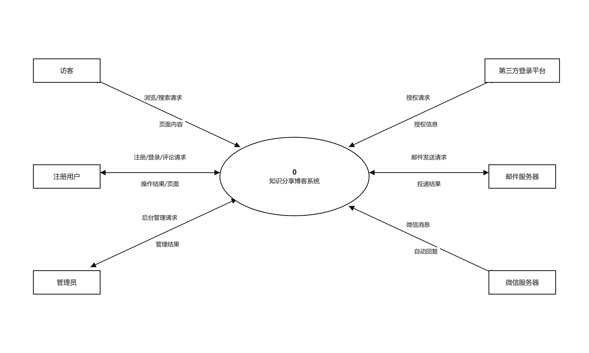
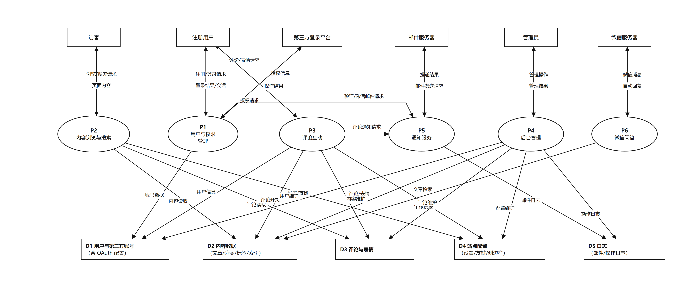
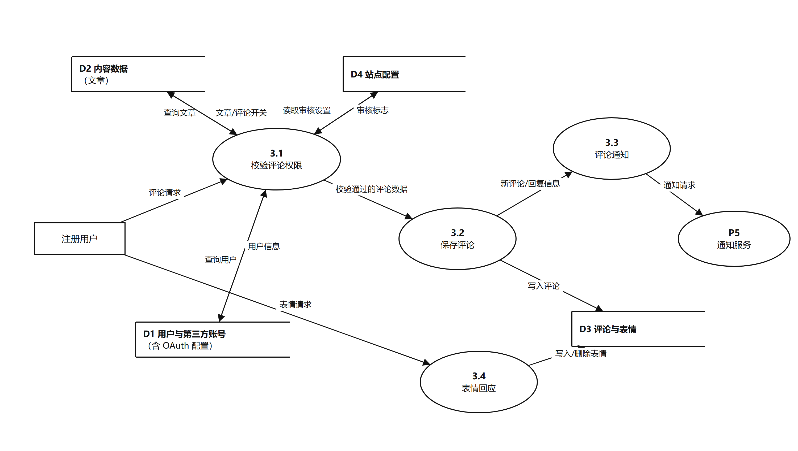
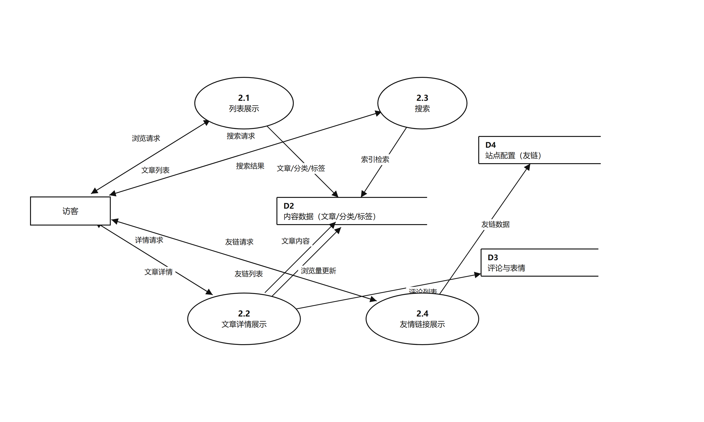

# 1.2 数据流图与数据字典（泛读报告 · 第 1 章第 2 节 初稿）

> 本节对应模板「1 开源软件的功能描述 →（2）数据流图和数据字典」。
> 图与表编号沿用报告统一规则：图 1-x、表 1-x，后续组装 docx 时按全篇顺序重排。

---

## 1 数据流图

### 1.1 图形符号约定

| 符号 | 含义 |
|---|---|
| 矩形 | 外部实体（与系统交互的人或外部系统） |
| 椭圆（编号 + 名称） | 加工（系统要完成的数据处理） |
| 左封闭、右开口的平行线框 | 数据存储（数据库表 / 索引等） |
| 带箭头的线（标注数据流名） | 数据流（数据及其流向） |

### 1.2 顶层数据流图

##### 图 1-2 顶层数据流图

顶层图把「知识分享」博客系统整体视为一个加工 **0**，两侧是与系统交互的 6 个外部实体，共 12 条数据流：

| 序号 | 数据流 | 来源 → 去向 | 数据内容 |
|---|---|---|---|
| 1 | 浏览/搜索请求 | 访客 → 系统 | 分类/标签/归档入口、搜索关键词、分页参数 |
| 2 | 页面内容 | 系统 → 访客 | 文章列表、文章详情、搜索结果、友链页面 |
| 3 | 注册/登录/评论请求 | 注册用户 → 系统 | 账号密码、第三方授权信息、评论内容、表情回应 |
| 4 | 操作结果/页面 | 系统 → 注册用户 | 登录会话、提交结果、刷新后的页面 |
| 5 | 后台管理请求 | 管理员 → 系统 | 文章/分类/标签/评论/用户/站点配置的维护操作 |
| 6 | 管理结果 | 系统 → 管理员 | 管理列表、操作确认、统计数据 |
| 7 | 授权请求 | 系统 → 第三方登录平台 | OAuth 授权跳转（AppKey、回调地址、授权范围） |
| 8 | 授权信息 | 第三方登录平台 → 系统 | 授权码、openid、昵称、头像、邮箱 |
| 9 | 邮件发送请求 | 系统 → 邮件服务器 | 收件人、主题、正文（激活邮件/验证码/评论通知） |
| 10 | 投递结果 | 邮件服务器 → 系统 | 发送成功/失败结果 |
| 11 | 微信消息 | 微信服务器 → 系统 | 用户发送的关键词、命令文本 |
| 12 | 自动回复 | 系统 → 微信服务器 | 文章卡片、分类列表、帮助文本、聊天回复 |

### 1.3 0 层数据流图

##### 图 1-3 0 层数据流图

0 层图把系统分解为 6 个加工、5 个数据存储。

**加工清单**

| 编号 | 加工 | 职责 | 对应系统模块 |
|---|---|---|---|
| P1 | 用户与权限管理 | 注册、登录、第三方登录、找回密码、会话与权限校验 | `accounts`、`oauth` 应用 |
| P2 | 内容浏览与搜索 | 文章列表/详情、分类/标签/归档浏览、搜索、友链展示 | `blog` 应用、Haystack 搜索 |
| P3 | 评论互动 | 发表评论、回复、评论审核状态、表情回应 | `comments` 应用 |
| P4 | 后台管理 | 文章/分类/标签、评论、用户、站点配置的维护与日志 | `djangoblog` 管理站点、各应用 admin |
| P5 | 通知服务 | 激活邮件、验证码邮件、评论通知邮件的发送与日志 | `djangoblog.utils`、`comments.utils` |
| P6 | 微信问答 | 公众号消息处理：文章检索、分类/最新文章查询、智能回复 | `servermanager` 应用 |

**数据存储清单**

| 编号 | 数据存储 | 组成（物理表） |
|---|---|---|
| D1 | 用户与第三方账号（含 OAuth 配置） | `auth_user`、`oauth_oauthuser`、`oauth_oauthconfig`、`django_session` |
| D2 | 内容数据（文章/分类/标签/索引） | `blog_article`、`blog_category`、`blog_tag`、`blog_article_tags`、搜索索引（Whoosh/Elasticsearch） |
| D3 | 评论与表情 | `comments_comment`、`comments_commentreaction` |
| D4 | 站点配置（设置/友链/侧边栏） | `blog_blogsettings`、`blog_links`、`blog_sidebar`、`django_site`、`servermanager_commands` |
| D5 | 日志（邮件/操作日志） | `servermanager_emailsendlog`、`django_admin_log` |

**分层与编号规则**：顶层加工记为 0；0 层加工编号 P1～P6；1 层子加工编号「父加工号.序号」（如 P3 分解为 3.1～3.4）；数据存储统一编号 D1～D5，各层保持一致，便于与数据字典对照。

### 1.4 P3 评论互动的 1 层图

##### 图 1-4 P3 评论互动 1 层图

| 编号 | 子加工 | 输入 | 输出 / 说明 |
|---|---|---|---|
| 3.1 | 校验评论权限 | 评论请求；用户信息；文章评论开关；审核设置 | 校验登录状态、文章是否关闭评论、内容是否合法（非空且不超过 300 字） |
| 3.2 | 保存评论 | 校验通过的评论数据 | 写入评论（关联文章/用户/父评论），按审核设置决定是否立即启用 |
| 3.3 | 评论通知 | 新评论/回复信息 | 组装通知内容，向 P5 提交通知请求（回复时通知被回复者） |
| 3.4 | 表情回应 | 表情请求 | 对评论写入/取消表情反应（同一用户同一表情只能一次） |

### 1.5 P2 内容浏览与搜索的 1 层图

##### 图 1-5 P2 内容浏览与搜索 1 层图

| 编号 | 子加工 | 输入 | 输出 / 说明 |
|---|---|---|---|
| 2.1 | 列表展示 | 浏览请求；文章/分类/标签 | 首页、分类页、标签页、归档页的文章列表（分页） |
| 2.2 | 文章详情展示 | 详情请求；文章内容；评论列表 | 文章正文、浏览量、相关推荐、评论列表；浏览量自增 |
| 2.3 | 搜索 | 搜索请求 | 从搜索索引检索并高亮关键词，返回结果列表 |
| 2.4 | 友情链接展示 | 友链请求；友链数据 | 友情链接列表页 |

> 说明：注册用户与访客的浏览流程相同（注册用户继承访客的浏览能力），1 层图只画访客以免重复；完整角色差异见用例图。

---

## 2 数据字典

### 2.1 组织方式

数据字典按「数据结构（表）→ 数据存储 → 数据流 → 加工说明」四部分组织。字段类型用数据库类型表示；「约束/取值」列出主键、唯一、可空与枚举取值。数据结构编号 DS-xx 与 0 层图的数据存储 D1～D5 对应。

### 2.2 数据结构

#### DS-01 用户（BlogUser → `auth_user`，属 D1）

| 字段 | 中文名 | 类型/长度 | 约束/取值 | 说明 |
|---|---|---|---|---|
| id | 用户编号 | int | 主键，自增 | |
| username | 用户名 | varchar(150) | 唯一，必填 | 登录名 |
| password | 密码 | varchar(128) | 必填 | 密码摘要（不可逆） |
| email | 邮箱 | varchar(254) | 可空 | 用于激活、找回密码、评论通知 |
| is_active | 是否激活 | bool | 默认 False | 注册后需邮箱验证才置 True |
| is_staff | 后台权限 | bool | 默认 False | 是否可登录管理站点 |
| is_superuser | 超级用户 | bool | 默认 False | 全部权限 |
| last_login | 最后登录时间 | datetime | 可空 | 登录成功时更新 |
| date_joined | 注册时间 | datetime | 必填 | |
| nickname | 昵称 | varchar(100) | 可空 | 页面展示名 |
| source | 注册来源 | varchar(100) | 可空 | Register / OAuth |
| creation_time | 创建时间 | datetime | 必填 | |
| last_modify_time | 修改时间 | datetime | 必填 | |

#### DS-02 第三方账号（OAuthUser → `oauth_oauthuser`，属 D1）

| 字段 | 中文名 | 类型/长度 | 约束/取值 | 说明 |
|---|---|---|---|---|
| id | 编号 | int | 主键，自增 | |
| author_id | 绑定用户 | int | 外键→DS-01，可空 | 未绑定/首次登录时为空 |
| openid | 平台用户标识 | varchar(50) | 必填 | 第三方平台唯一标识 |
| nickname | 平台昵称 | varchar(50) | 必填 | |
| token | 访问令牌 | varchar(150) | 可空 | 调用平台接口用 |
| picture | 头像地址 | varchar(350) | 可空 | |
| type | 平台类型 | varchar(50) | 必填 | github/weibo/qq 等 |
| email | 平台邮箱 | varchar(50) | 可空 | 缺邮箱时进入「补充邮箱」流程 |
| metadata | 扩展信息 | text | 可空 | JSON 序列化的平台原始信息 |
| creation_time | 创建时间 | datetime | 必填 | |
| last_modify_time | 修改时间 | datetime | 必填 | |

#### DS-03 第三方登录配置（OAuthConfig → `oauth_oauthconfig`，属 D1）

| 字段 | 中文名 | 类型/长度 | 约束/取值 | 说明 |
|---|---|---|---|---|
| id | 编号 | int | 主键，自增 | |
| type | 平台类型 | varchar(10) | weibo/google/github/facebook/qq | 不同平台各一条配置 |
| appkey | 应用 Key | varchar(200) | 必填 | 平台申请 |
| appsecret | 应用密钥 | varchar(200) | 必填 | 平台申请 |
| callback_url | 回调地址 | varchar(200) | 必填 | 授权回调 |
| is_enable | 是否启用 | bool | 默认 True | 控制登录页按钮显示 |
| creation_time / last_modify_time | 时间 | datetime | 必填 | |

#### DS-04 会话（Session → `django_session`，属 D1）

| 字段 | 中文名 | 类型/长度 | 约束/取值 | 说明 |
|---|---|---|---|---|
| session_key | 会话键 | varchar(40) | 主键 | 浏览器 Cookie 中保存 |
| session_data | 会话数据 | text | 必填 | 序列化的登录状态等 |
| expire_date | 过期时间 | datetime | 必填 | 「记住我」延长有效期 |

#### DS-05 文章（Article → `blog_article`，属 D2）

| 字段 | 中文名 | 类型/长度 | 约束/取值 | 说明 |
|---|---|---|---|---|
| id | 文章编号 | int | 主键，自增 | |
| title | 标题 | varchar(200) | 唯一，必填 | |
| body | 正文 | longtext | 必填 | Markdown 格式 |
| pub_time | 发布时间 | datetime | 必填 | |
| status | 文章状态 | char(1) | d=草稿，p=已发布 | |
| comment_status | 评论开关 | char(1) | o=开放，c=关闭 | 关闭后拒绝新评论 |
| type | 内容类型 | char(1) | a=文章，p=页面 | |
| views | 浏览量 | int | 默认 0 | 详情页访问自增 |
| author_id | 作者 | int | 外键→DS-01 | |
| category_id | 分类 | int | 外键→DS-06 | 必填 |
| article_order | 排序权重 | int | 默认 0 | 置顶用 |
| show_toc | 显示目录 | bool | 默认 False | 详情页是否显示目录 |
| tags | 标签 | 多对多→DS-07 | | 一篇文章多个标签 |
| creation_time / last_modify_time | 时间 | datetime | 必填 | |

#### DS-06 分类（Category → `blog_category`，属 D2）

| 字段 | 中文名 | 类型/长度 | 约束/取值 | 说明 |
|---|---|---|---|---|
| id | 分类编号 | int | 主键，自增 | |
| name | 分类名 | varchar(30) | 唯一，必填 | |
| parent_category_id | 父分类 | int | 外键→自身，可空 | 支持多级分类 |
| slug | URL 别名 | varchar(60) | 默认 no-slug | 分类页地址 |
| index | 排序 | int | 默认 0 | |
| creation_time / last_modify_time | 时间 | datetime | 必填 | |

#### DS-07 标签（Tag → `blog_tag`，属 D2）

| 字段 | 中文名 | 类型/长度 | 约束/取值 | 说明 |
|---|---|---|---|---|
| id | 标签编号 | int | 主键，自增 | |
| name | 标签名 | varchar(30) | 唯一，必填 | |
| slug | URL 别名 | varchar(60) | 默认 no-slug | 标签页地址 |
| creation_time / last_modify_time | 时间 | datetime | 必填 | |

#### DS-08 搜索索引（Haystack 索引，属 D2，派生数据）

| 字段 | 中文名 | 类型 | 约束/取值 | 说明 |
|---|---|---|---|---|
| text | 索引全文 | text | | 标题 + 正文分词结果（jieba 分词） |
| title | 标题 | text | | 用于高亮 |
| body | 正文 | text | | |
| category | 分类名 | text | | |
| tags | 标签 | text（多值） | | |
| author | 作者 | text | | |
| pub_time | 发布时间 | datetime | | 排序用 |

> 搜索索引由 `HAYSTACK_SIGNAL_PROCESSOR = RealtimeSignalProcessor` 在文章保存时实时更新；存储于 `whoosh_index/` 或 Elasticsearch。

#### DS-09 评论（Comment → `comments_comment`，属 D3）

| 字段 | 中文名 | 类型/长度 | 约束/取值 | 说明 |
|---|---|---|---|---|
| id | 评论编号 | int | 主键，自增 | |
| body | 正文 | text | 必填，≤300 字 | 支持 Markdown |
| author_id | 评论者 | int | 外键→DS-01 | |
| article_id | 所属文章 | int | 外键→DS-05 | |
| parent_comment_id | 父评论 | int | 外键→自身，可空 | 有值即为回复，支持多层嵌套 |
| is_enable | 是否显示 | bool | 默认 False | 审核通过或站点未开审核时为 True |
| creation_time / last_modify_time | 时间 | datetime | 必填 | |

#### DS-10 评论表情（CommentReaction → `comments_commentreaction`，属 D3）

| 字段 | 中文名 | 类型/长度 | 约束/取值 | 说明 |
|---|---|---|---|---|
| id | 编号 | int | 主键，自增 | |
| comment_id | 评论 | int | 外键→DS-09 | |
| user_id | 用户 | int | 外键→DS-01 | |
| reaction_type | 表情类型 | varchar(10) | 👍👎❤️😄🎉😕🚀👀 共 8 种 | |
| created_at | 创建时间 | datetime | 自动 | |
| — | 唯一约束 | — | (comment, user, reaction_type) | 同一用户对同一评论的同种表情只能一次 |

#### DS-11 站点设置（BlogSettings → `blog_blogsettings`，属 D4）

| 字段 | 中文名 | 类型/长度 | 约束/取值 | 说明 |
|---|---|---|---|---|
| site_name | 站点名称 | varchar(200) | 必填 | |
| site_description | 站点描述 | text(1000) | 必填 | 页脚/SEO 用 |
| site_seo_description | SEO 描述 | text(1000) | 必填 | |
| site_keywords | SEO 关键词 | text(1000) | 必填 | |
| article_sub_length | 摘要长度 | int | 默认 300 | 首页摘要截断 |
| sidebar_article_count | 侧栏文章数 | int | 默认 10 | |
| sidebar_comment_count | 侧栏评论数 | int | 默认 5 | |
| article_comment_count | 评论分页数 | int | 默认 5 | |
| open_site_comment | 全站评论开关 | bool | 默认 True | |
| comment_need_review | 评论需审核 | bool | 默认 False | **评论审核功能的总开关** |
| show_google_adsense | 显示广告 | bool | 默认 False | |
| google_adsense_codes | 广告代码 | text(2000) | 可空 | |
| color_scheme | 主题配色 | varchar(20) | purple/blue/green/orange/pink/red | |
| global_header / global_footer | 公共头/尾 | text | 可空 | 自定义 HTML |
| beian_code | 备案号 | varchar(2000) | 可空 | |
| show_gongan_code / gongan_beiancode | 公安备案 | bool / text | 可空 | |
| analytics_code | 统计代码 | text(1000) | | |

#### DS-12 友情链接（Links → `blog_links`，属 D4）

| 字段 | 中文名 | 类型/长度 | 约束/取值 | 说明 |
|---|---|---|---|---|
| id | 编号 | int | 主键，自增 | |
| name | 链接名称 | varchar(30) | 唯一，必填 | |
| link | 链接地址 | varchar(200) | 必填 | URL |
| sequence | 顺序 | int | 唯一，必填 | |
| is_enable | 是否启用 | bool | 默认 True | |
| show_type | 展示位置 | char(1) | i=首页，l=列表，p=文章，a=全部，s=幻灯片 | |
| creation_time / last_modify_time | 时间 | datetime | 必填 | |

#### DS-13 侧边栏（SideBar → `blog_sidebar`，属 D4）

| 字段 | 中文名 | 类型/长度 | 约束/取值 | 说明 |
|---|---|---|---|---|
| id | 编号 | int | 主键，自增 | |
| name | 名称 | varchar(100) | 必填 | |
| content | 内容 | text | 必填 | HTML 片段 |
| sequence | 顺序 | int | 唯一，必填 | |
| is_enable | 是否启用 | bool | 默认 True | |
| creation_time / last_modify_time | 时间 | datetime | 必填 | |

#### DS-14 站点（Site → `django_site`，属 D4）

| 字段 | 中文名 | 类型/长度 | 约束/取值 | 说明 |
|---|---|---|---|---|
| id | 编号 | int | 主键 | |
| domain | 域名 | varchar(100) | 必填 | 生成绝对链接、站点地图 |
| name | 站点名 | varchar(50) | 必填 | |

#### DS-15 后台命令（commands → `servermanager_commands`，属 D4）

| 字段 | 中文名 | 类型/长度 | 约束/取值 | 说明 |
|---|---|---|---|---|
| id | 编号 | int | 主键 | |
| title | 命令标题 | varchar(300) | 必填 | |
| command | 命令内容 | varchar(2000) | 必填 | 后台可执行的命令 |
| describe | 描述 | varchar(300) | 必填 | |
| creation_time / last_modify_time | 时间 | datetime | 自动 | |

#### DS-16 邮件发送日志（EmailSendLog → `servermanager_emailsendlog`，属 D5）

| 字段 | 中文名 | 类型/长度 | 约束/取值 | 说明 |
|---|---|---|---|---|
| id | 编号 | int | 主键 | |
| emailto | 收件人 | varchar(300) | 必填 | 多个用逗号分隔 |
| title | 邮件主题 | varchar(2000) | 必填 | |
| content | 邮件正文 | text | 必填 | HTML |
| send_result | 发送结果 | bool | 默认 False | 成功/失败 |
| creation_time | 创建时间 | datetime | 自动 | |

#### DS-17 操作日志（LogEntry → `django_admin_log`，属 D5）

| 字段 | 中文名 | 类型/长度 | 约束/取值 | 说明 |
|---|---|---|---|---|
| id | 编号 | int | 主键 | |
| action_time | 操作时间 | datetime | 自动 | |
| user_id | 操作人 | int | 外键→DS-01 | |
| content_type_id | 对象类型 | int | 外键→django_content_type | |
| object_id | 对象编号 | text | 可空 | 被操作记录的主键 |
| object_repr | 对象名称 | varchar(200) | 必填 | 冗余展示 |
| action_flag | 操作类型 | smallint | 1=新增，2=修改，3=删除 | |
| change_message | 修改说明 | text | 必填 | |

### 2.3 数据存储

| 编号 | 数据存储 | 组成 | 物理实现 | 说明 |
|---|---|---|---|---|
| D1 | 用户与第三方账号（含 OAuth 配置） | DS-01～DS-04 | MySQL `dailyblog` 库 + 会话表 | 账号、第三方绑定、登录配置、会话 |
| D2 | 内容数据（文章/分类/标签/索引） | DS-05～DS-08 | MySQL + 搜索索引（Whoosh/ES） | 索引由文章保存信号实时更新 |
| D3 | 评论与表情 | DS-09～DS-10 | MySQL | 支持嵌套回复与 8 种表情 |
| D4 | 站点配置（设置/友链/侧边栏） | DS-11～DS-15 | MySQL | 后台可维护 |
| D5 | 日志（邮件/操作日志） | DS-16～DS-17 | MySQL | 邮件发送结果、后台操作审计 |

### 2.4 主要数据流

| 数据流 | 来源 → 去向 | 组成 |
|---|---|---|
| 浏览/搜索请求 | 访客 → P2 | 分类/标签/归档入口、关键词、分页号 |
| 页面内容 | P2 → 访客 | 文章列表/详情、搜索结果、友链 |
| 注册/登录请求 | 注册用户 → P1 | 用户名、密码、邮箱、验证码 |
| 登录结果/会话 | P1 → 注册用户 | 会话标识、登录标记、跳转地址 |
| 授权请求 | P1 → 第三方登录平台 | AppKey、回调地址、授权范围 |
| 授权信息 | 第三方登录平台 → P1 | 授权码、openid、昵称、头像、邮箱 |
| 验证/激活邮件请求 | P1 → P5 | 收件人、邮件类型（激活/验证码）、验证码 |
| 评论/表情请求 | 注册用户 → P3 | 文章编号、评论正文、父评论编号、表情类型 |
| 校验通过的评论数据 | 3.1 → 3.2 | 用户、文章、正文、审核标志 |
| 评论通知请求 | P3 → P5 | 评论/回复信息、收件人 |
| 邮件发送请求 | P5 → 邮件服务器 | 收件人、主题、HTML 正文 |
| 投递结果 | 邮件服务器 → P5 | 成功/失败标志 |
| 用户信息 | D1 → P1/P3 | 用户编号、昵称、邮箱、权限 |
| 账号数据 | P1 → D1 | 新用户、第三方绑定、会话记录 |
| 内容读取 | D2 → P2 | 文章、分类、标签、索引结果 |
| 评论读取 | D3 → P2 | 某文章的评论列表（含嵌套、表情统计） |
| 评论/表情数据 | P3 → D3 | 新评论、启用状态、表情反应 |
| 评论开关 / 审核设置 | D2/D4 → P3 | 文章评论状态、站点审核标志 |
| 内容维护 | P4 → D2 | 文章/分类/标签的新增、修改、删除 |
| 用户维护 / 评论维护 / 配置维护 | P4 → D1/D3/D4 | 后台管理数据 |
| 操作日志 / 邮件日志 | P4/P5 → D5 | 管理操作记录、邮件发送结果 |
| 文章检索 | D2 → P6 | 关键词匹配的文章、分类、最新文章 |
| 微信消息 / 自动回复 | 微信服务器 ↔ P6 | 命令文本 / 文章卡片、分类列表、回复文本 |

### 2.5 加工说明

**0 层加工**

| 编号 | 加工 | 输入 | 输出 | 加工逻辑（要点） |
|---|---|---|---|---|
| P1 | 用户与权限管理 | 注册/登录请求、授权信息、账号数据 | 登录结果/会话、账号数据、验证邮件请求 | 校验账号密码/第三方授权；注册后置未激活并发送激活邮件；找回密码校验邮箱验证码（5 分钟有效）；建立会话 |
| P2 | 内容浏览与搜索 | 浏览/搜索请求、内容读取、评论读取、站点设置 | 页面内容 | 按状态过滤已发布文章；分类/标签/归档分组；关键词检索索引并高亮；详情页浏览量自增 |
| P3 | 评论互动 | 评论/表情请求、用户信息、评论开关、审核设置 | 评论/表情数据、操作结果、通知请求 | 校验登录与文章评论开关；正文非空且 ≤300 字；保存并关联父评论；按审核设置决定是否立即显示；汇总表情统计 |
| P4 | 后台管理 | 管理操作 | 管理结果、内容/用户/评论/配置维护、操作日志 | 管理员身份校验；维护文章/分类/标签/评论/用户/站点配置；记录操作日志 |
| P5 | 通知服务 | 验证/激活邮件请求、评论通知请求 | 邮件发送请求、邮件日志 | 组装邮件内容；调用 SMTP 发送；记录发送结果；评论通知异步发送 |
| P6 | 微信问答 | 微信消息 | 自动回复、文章检索 | 按命令解析：`?关键词` 检索文章、`category` 查分类、`recent` 查最新、`help` 帮助；未匹配时智能聊天 |

**1 层加工（P3 评论互动）**

| 编号 | 加工 | 输入 | 输出 | 加工逻辑（要点） |
|---|---|---|---|---|
| 3.1 | 校验评论权限 | 评论请求、用户信息、文章评论开关、审核设置 | 校验通过的评论数据 | 校验登录；文章评论已关闭则拒绝；校验内容非空且 ≤300 字 |
| 3.2 | 保存评论 | 校验通过的评论数据 | 评论数据 | 创建评论并关联文章/用户/父评论；按审核设置置 `is_enable` |
| 3.3 | 评论通知 | 新评论/回复信息 | 通知请求 | 回复时同时通知被回复者；异步提交 P5 |
| 3.4 | 表情回应 | 表情请求 | 表情数据 | 校验登录；同一用户同一表情只能记录一次，可取消 |

**1 层加工（P2 内容浏览与搜索）**

| 编号 | 加工 | 输入 | 输出 | 加工逻辑（要点） |
|---|---|---|---|---|
| 2.1 | 列表展示 | 浏览请求、文章/分类/标签 | 文章列表 | 仅取已发布文章；按分类/标签/归档过滤并分页 |
| 2.2 | 文章详情展示 | 详情请求、文章内容、评论列表 | 文章详情 | 渲染正文/相关推荐/评论；浏览量加 1 |
| 2.3 | 搜索 | 搜索请求、索引 | 搜索结果 | 分词检索索引；标题命中高亮；无结果给空状态 |
| 2.4 | 友情链接展示 | 友链请求、友链数据 | 友链列表 | 取启用状态的友链按顺序展示 |

---

## 3 与后续章节的衔接

1. 本节的数据存储 D1～D5 将在第 3 章「数据模型分析」（UML 类图/ER 图）中展开实体关系；
2. P1～P6 的加工对应第 4 章「软件架构及各个包和类的作用」中的应用包，第 5 章将给出「功能—类」对应表；
3. 评论审核与关闭评论的结论（`comment_need_review`、`comment_status`）将在第 6 章总结中作为必答点再次说明。
