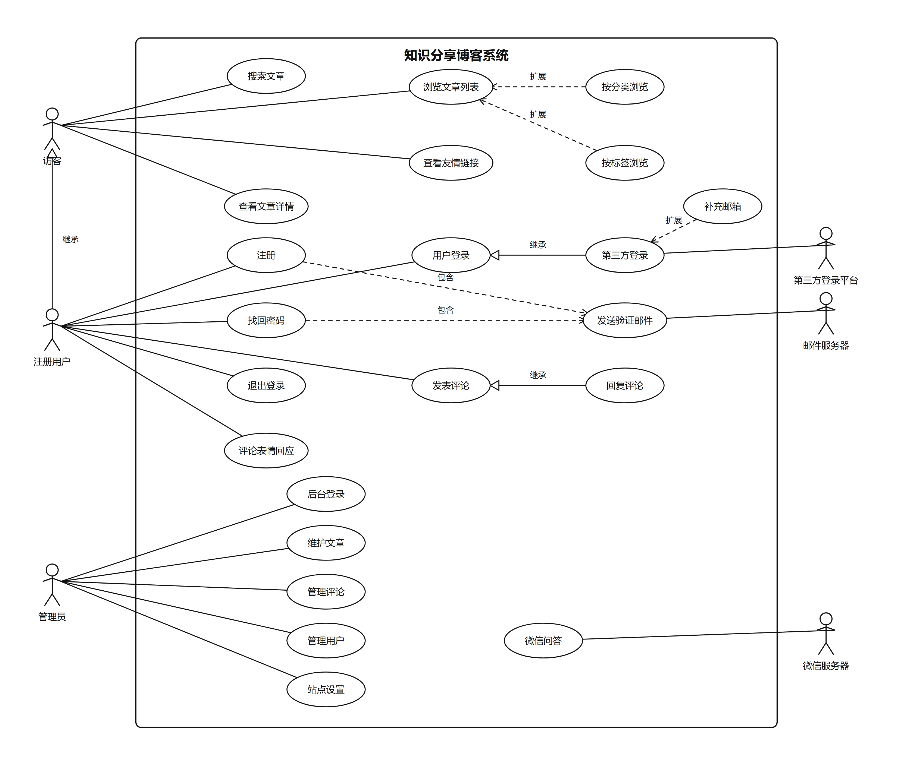

# 1.1 用例图和用例图说明

> 本节对应模板「1 开源软件的功能描述 →（1）用例图和用例图说明」。
> 用例图详细绘制说明见 `doc/用例图绘制蓝图.md`；完整用例说明见 `doc/用例说明-发表评论.md`；22 张用例顺序图见 1.3 节。

## 1 系统功能概述

「知识分享」博客系统是在开源项目 DjangoBlog 基础上二次开发的博客网站。按业务目标可归纳为五个功能域：

| 功能域 | 主要内容 | 涉及执行者 |
|---|---|---|
| 内容浏览与搜索 | 文章列表、文章详情、分类/标签/作者/归档浏览、站内搜索、友情链接 | 访客、注册用户 |
| 账户与登录 | 注册、登录、退出、找回密码、第三方登录、补充邮箱 | 访客、注册用户、第三方登录平台、邮件服务器 |
| 评论互动 | 发表评论、回复评论、评论表情回应 | 注册用户（邮件服务器参与通知） |
| 后台管理 | 后台登录、文章/分类/标签/评论/用户/站点配置维护 | 管理员 |
| 微信服务 | 公众号消息问答（文章检索、分类/最新文章查询、智能回复） | 微信服务器 |

## 2 用例图

##### 图 1-1 用例图

用例图的执行者与用例对应关系如下（22 个用例、6 个执行者）：

| 执行者 | 关联用例 |
|---|---|
| 访客 | 搜索文章、浏览文章列表、查看文章详情、查看友情链接 |
| 注册用户 | 注册、用户登录、找回密码、退出登录、发表评论、评论表情回应 |
| 管理员 | 后台登录、维护文章、管理评论、管理用户、站点设置 |
| 第三方登录平台 | 第三方登录 |
| 邮件服务器 | 发送验证邮件 |
| 微信服务器 | 微信问答 |

用例之间的三种关系（与教材语法一致）：

- **包含（2 条）**：注册 → 发送验证邮件；找回密码 → 发送验证邮件（邮件是必经步骤）；
- **扩展（3 条）**：按分类浏览 → 浏览文章列表；按标签浏览 → 浏览文章列表；补充邮箱 → 第三方登录（条件性可选行为）；
- **继承（3 条）**：第三方登录 → 用户登录；回复评论 → 发表评论（用例泛化）；注册用户 → 访客（执行者泛化）。

## 3 用例说明（核心用例：发表评论）

### 表 1-1 用例说明 · 发表评论

| 项目 | 内容 |
|---|---|
| 用例编号 | UC-14（对应用例图 U14） |
| 用例名称 | 发表评论 |
| 参与者 | 主要：注册用户；次要：邮件服务器（通知邮件环节） |
| 简述（目标） | 注册用户在文章详情页发表评论，与作者及其他读者交流互动；回复他人评论时由子用例「回复评论」处理 |
| 涉及界面 | 文章详情页评论区（输入框与「发表评论」按钮） |
| 前置条件 | 用户已注册并登录；文章存在且未关闭评论 |
| 后置条件 | 评论保存并与文章/用户/父评论关联；按审核设置立即显示或进入待审；页面定位到新评论；通知邮件已异步发送并记录日志 |

**基本事件流**

| 步骤 | 事件 |
|---|---|
| 1 | 用户打开文章详情页，系统显示正文、评论列表与评论输入框 |
| 2 | 用户输入评论内容（非空，不超过 300 字，支持 Markdown） |
| 3 | 用户点击「发表评论」提交 |
| 4 | 系统校验用户身份与文章评论开关均合法 |
| 5 | 系统校验评论内容合法（非空、长度不超过 300 字） |
| 6 | 系统保存评论，关联文章与用户；若带有父评论标识则关联父评论（该分支由「回复评论」执行） |
| 7 | 系统按站点设置决定可见性：未开启审核时评论立即启用显示 |
| 8 | 系统刷新页面并自动定位到新评论 |
| 9 | 系统异步发送通知邮件（评论者；回复时另通知被回复者），并记录发送日志 |
| 10 | 用例结束，评论区出现该评论 |

**备选事件流**

| 编号 | 触发条件 | 处理 |
|---|---|---|
| 4a | 用户未登录或会话失效 | 提示登录并跳转登录页；登录后回到原文章页从步骤 2 重新开始 |
| 7a | 站点开启"评论需审核" | 评论保存为待审核状态，暂不显示；管理员在后台审核通过后显示 |
| 9a | 通知邮件发送失败 | 记录失败日志，不中断用例，评论发布不受影响 |

**异常事件流**

| 编号 | 触发条件 | 处理 |
|---|---|---|
| 4b | 文章已关闭评论 | 提示"该文章评论已关闭"，用例终止 |
| 5a | 内容为空或超过 300 字 | 提示校验错误，返回步骤 2 修改后重试 |
| 6a | 文章已被删除 | 返回 404 错误页，用例终止 |

**业务规则**

| 编号 | 规则 |
|---|---|
| BR1 | 评论必须由已登录用户发表，匿名用户不可评论 |
| BR2 | 评论正文 1～300 字，支持 Markdown |
| BR3 | 评论是否立即显示由站点设置"评论是否需要审核"决定 |
| BR4 | 回复必须挂在同篇文章的某条父评论下，支持多层嵌套 |
| BR5 | 评论保存后异步发送通知邮件（评论者；回复时含被回复者），并记录邮件日志 |
| BR6 | 文章可单独关闭评论，关闭后拒绝一切新评论 |

> 说明：其余 21 个用例的顺序图见 1.3 节；每个用例均按"1 界面类 + 1 控制类 + 若干实体类"建模，只画主要执行场景。
