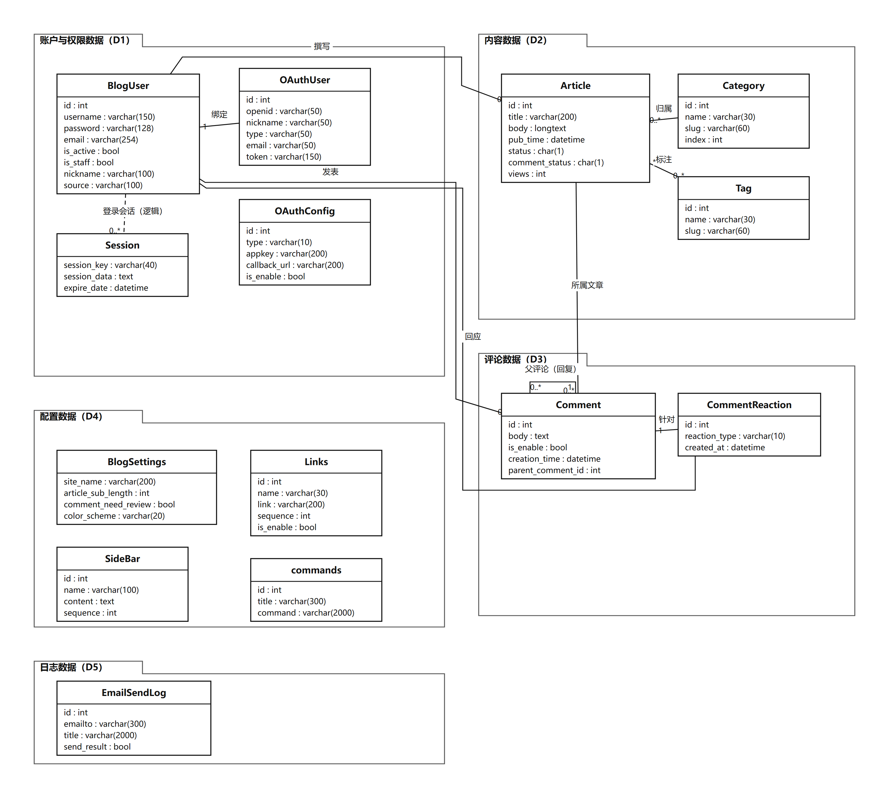

# 3 数据模型分析（泛读报告 · 第 3 章 初稿）

> 本节对应模板「3 数据模型分析」。此前没有交过数据模型分析，故按项目代码（`models.py`）补画 UML 类图并整理实体关系。
> 编号与数据字典（DS-xx）、数据流图（D1～D5）保持一致，便于交叉对照。

## 1 数据模型类图

##### 图 3-1 数据模型 UML 类图

类图按数据流图中的 5 个数据存储组织为 5 个包：

| 包 | 对应数据存储 | 实体 |
|---|---|---|
| 账户与权限数据（D1） | D1 | BlogUser（用户）、OAuthUser（第三方账号）、OAuthConfig（第三方登录配置）、Session（会话） |
| 内容数据（D2） | D2 | Article（文章）、Category（分类）、Tag（标签） |
| 评论数据（D3） | D3 | Comment（评论）、CommentReaction（评论表情） |
| 配置数据（D4） | D4 | BlogSettings（站点设置）、Links（友情链接）、SideBar（侧边栏）、commands（后台命令） |
| 日志数据（D5） | D5 | EmailSendLog（邮件发送日志） |

## 2 实体说明

| 实体（模型类） | 中文名 | 所属存储 | 主要字段 | 职责说明 |
|---|---|---|---|---|
| BlogUser | 用户 | D1 | username、password、email、is_active、is_staff、nickname、source | 本站账号；`is_active` 在邮箱验证前为 False；`is_staff` 控制后台权限；`source` 记录注册来源 |
| OAuthUser | 第三方账号 | D1 | author、openid、nickname、token、picture、type、email、metadata | 第三方平台账号与本站用户的绑定关系；`author` 为空表示尚未绑定 |
| OAuthConfig | 第三方登录配置 | D1 | type、appkey、appsecret、callback_url、is_enable | 每个平台一条 OAuth 配置，登录页据此显示第三方登录入口 |
| Session | 会话 | D1 | session_key、session_data、expire_date | Django 会话表；保存登录状态与有效期（「记住我」延长） |
| Article | 文章 | D2 | title、body、pub_time、status、comment_status、views、author、category、tags | 博客正文；`status` 区分草稿/发布；`comment_status` 控制该篇能否评论；`views` 浏览量 |
| Category | 分类 | D2 | name、parent_category、slug、index | 支持多级分类（自关联父分类） |
| Tag | 标签 | D2 | name、slug | 与文章多对多 |
| Comment | 评论 | D3 | body（≤300 字）、author、article、parent_comment、is_enable | 支持无限嵌套回复；`is_enable` 为审核/显示状态 |
| CommentReaction | 评论表情 | D3 | comment、user、reaction_type、created_at | 8 种表情回应；同一用户对同一评论的同种表情唯一 |
| BlogSettings | 站点设置 | D4 | site_name、article_sub_length、comment_need_review、color_scheme 等 | 全站参数；`comment_need_review` 是评论审核总开关 |
| Links | 友情链接 | D4 | name、link、sequence、is_enable、show_type | 友链展示与排序 |
| SideBar | 侧边栏 | D4 | name、content、sequence、is_enable | 可配置的侧边栏 HTML 片段 |
| commands | 后台命令 | D4 | title、command、describe | 后台维护的可执行命令（配合微信端管理） |
| EmailSendLog | 邮件发送日志 | D5 | emailto、title、content、send_result | 记录每封邮件的发送结果 |

> 另有两个 Django 内置数据结构不在类图中展开：`django_site`（站点域名，DS-14）与 `django_admin_log`（后台操作日志，DS-17）。

## 3 实体关系

| 关系 | 多重性 | 实现（外键/约束） | 说明 |
|---|---|---|---|
| 用户—文章 | 1 : 0..* | `Article.author` → `BlogUser` | 一个用户可写多篇文章，文章必有一个作者 |
| 用户—评论 | 1 : 0..* | `Comment.author` → `BlogUser` | 评论必须有作者 |
| 用户—评论表情 | 1 : 0..* | `CommentReaction.user` → `BlogUser` | 用户可对多条评论回应 |
| 用户—第三方账号 | 1 : 0..* | `OAuthUser.author` → `BlogUser`（可空） | 一个用户可绑定多个第三方账号；未绑定时为空 |
| 文章—分类 | 0..* : 1 | `Article.category` → `Category`（必填） | 每篇文章必属一个分类 |
| 分类—分类 | 1 : 0..* | `Category.parent_category` → 自身（可空） | 多级分类树 |
| 文章—标签 | 0..* : 0..* | `Article.tags` 多对多 | 一篇文章多个标签，一个标签多篇文章 |
| 评论—文章 | 0..* : 1 | `Comment.article` → `Article` | 评论必属一篇文章 |
| 评论—评论 | 0..* : 1 | `Comment.parent_comment` → 自身（可空） | 有父评论即为回复，支持任意层级 |
| 评论—评论表情 | 1 : 0..* | `CommentReaction.comment` → `Comment` | 一条评论可有多种表情 |
| 用户—会话 | 1 : 0..* | 逻辑关联（会话数据保存用户标识） | 一个用户可有多个登录会话（多端登录） |

## 4 主要约束与业务规则

| 编号 | 约束/规则 | 依据 |
|---|---|---|
| C1 | 文章标题唯一，文章必须指定分类 | `Article.title unique`、`category` 必填 |
| C2 | 文章状态取值 `d`（草稿）/`p`（发布）；评论开关 `o`（开放）/`c`（关闭） | `STATUS_CHOICES`、`COMMENT_STATUS` |
| C3 | 评论正文非空且不超过 300 字，支持 Markdown | `Comment.body max_length=300` |
| C4 | 评论默认 `is_enable=False`；站点未开启审核时保存即置 True | `Comment.is_enable` 默认值 + `CommentPostView` 逻辑 |
| C5 | 同一用户对同一评论的同种表情只能记录一次 | `unique_together = (comment, user, reaction_type)` |
| C6 | 用户注册后 `is_active=False`，邮箱验证通过才可登录 | `RegisterView` + `account_result` 激活逻辑 |
| C7 | 第三方账号可缺邮箱，需走「补充邮箱」流程后再绑定 | `OAuthUser.email` 可空 + `RequireEmailView` |
| C8 | 评论列表查询按 `(article, parent_comment, is_enable)` 建组合索引 | `Comment.Meta.indexes` |
| C9 | 站点配置为单例式全局参数；评论审核开关为布尔值 | `BlogSettings` 字段定义 |

## 5 与数据流图、数据字典的对应

| 数据流图 | 数据存储 | 数据字典 | 类图包 |
|---|---|---|---|
| 0 层图 | D1 用户与第三方账号（含 OAuth 配置） | DS-01～DS-04 | 账户与权限数据 |
| 0 层图 | D2 内容数据（文章/分类/标签/索引） | DS-05～DS-08 | 内容数据（搜索索引为派生结构） |
| 0 层图 | D3 评论与表情 | DS-09～DS-10 | 评论数据 |
| 0 层图 | D4 站点配置（设置/友链/侧边栏） | DS-11～DS-15 | 配置数据 |
| 0 层图 | D5 日志（邮件/操作日志） | DS-16～DS-17 | 日志数据（操作日志为 Django 内置表） |

## 6 数据模型特点小结

1. **围绕内容与互动组织**：文章是核心实体，分类/标签/评论/表情围绕文章展开；用户贯穿所有互动。
2. **评论模型支持嵌套与审核**：`parent_comment` 自关联实现无限层级回复；`is_enable` 同时承担"审核状态/是否显示"两个语义，由站点设置统一控制。
3. **账户模型兼顾本地与第三方**：`BlogUser` 为本地账号，`OAuthUser` 记录第三方身份与绑定关系，`OAuthConfig` 管理平台接入参数。
4. **配置与日志独立成包**：站点设置、友链、侧边栏、后台命令、邮件日志均不依赖内容表，便于后台维护与审计。
