# 1.1 用例模型 · 用例顺序图（泛读报告 · 第 1 章第 1 节 配套）

> 本节配套报告 1.1「用例图和用例图说明」：22 个用例，每个一张顺序图（只画主要执行场景）。
> 每图按题目要求设计 **1 个界面类（«boundary»）+ 1 个控制类（«control»）+ 若干实体类（«entity»）**。
> 用例编号 U1～U22 与《用例图绘制蓝图》一致；图号按报告全篇顺序编排（图 1-6～图 1-27）。
> 发表评论、用户登录两张图的**逐条消息说明**见 `doc/顺序图-发表评论与用户登录.md`；全部图源（.puml）在 `doc/imgs/diagrams/sequence/`。

## 1 类设计总表

| 编号 | 用例 | 界面类 | 控制类 | 实体类 | 图号 |
|---|---|---|---|---|---|
| U1 | 搜索文章 | 搜索页界面 | 搜索控制器 | 搜索索引、文章 | 图 1-6 |
| U2 | 浏览文章列表 | 首页界面 | 文章列表控制器 | 文章、分类、标签、站点设置 | 图 1-7 |
| U3 | 按分类浏览 | 分类页界面 | 分类浏览控制器 | 分类、文章 | 图 1-8 |
| U4 | 查看文章详情 | 文章详情页界面 | 文章详情控制器 | 文章、用户、评论 | 图 1-9 |
| U5 | 查看友情链接 | 友情链接页界面 | 友情链接控制器 | 友情链接 | 图 1-10 |
| U6 | 按标签浏览 | 标签页界面 | 标签浏览控制器 | 标签、文章 | 图 1-11 |
| U7 | 注册 | 注册页界面 | 注册控制器 | 用户（+ 邮件服务器） | 图 1-12 |
| U8 | 用户登录 | 登录页界面 | 登录控制器 | 用户、会话 | 图 1-13 |
| U9 | 第三方登录 | 登录页界面 | 第三方登录控制器 | 第三方账号、用户、会话（+ 第三方登录平台） | 图 1-14 |
| U10 | 补充邮箱 | 补充邮箱页界面 | 补充邮箱控制器 | 第三方账号、用户 | 图 1-15 |
| U11 | 找回密码 | 找回密码页界面 | 找回密码控制器 | 用户、验证码（+ 邮件服务器） | 图 1-16 |
| U12 | 发送验证邮件 | 邮件服务接口 | 邮件通知控制器 | 用户、邮件日志（+ 邮件服务器） | 图 1-17 |
| U13 | 退出登录 | 顶部导航界面 | 登出控制器 | 用户、会话 | 图 1-18 |
| U14 | 发表评论 | 文章详情页界面 | 评论控制器 | 用户、文章、评论、站点设置（+ 邮件服务器） | 图 1-19 |
| U15 | 回复评论 | 文章详情页界面 | 评论控制器（继承自 U14） | 用户、文章、评论（+ 邮件服务器） | 图 1-20 |
| U16 | 评论表情回应 | 文章详情页界面 | 表情回应控制器 | 用户、评论、评论表情 | 图 1-21 |
| U17 | 后台登录 | 后台登录页界面 | 后台登录控制器 | 用户、会话 | 图 1-22 |
| U18 | 维护文章 | 文章管理界面 | 文章管理控制器 | 文章、分类、标签 | 图 1-23 |
| U19 | 管理评论 | 评论管理界面 | 评论管理控制器 | 评论、文章 | 图 1-24 |
| U20 | 管理用户 | 用户管理界面 | 用户管理控制器 | 用户、第三方账号 | 图 1-25 |
| U21 | 站点设置 | 站点设置界面 | 站点设置控制器 | 站点设置、友情链接、侧边栏 | 图 1-26 |
| U22 | 微信问答 | 微信消息接口 | 微信问答控制器 | 搜索索引、文章、分类（+ 微信服务器） | 图 1-27 |

## 2 统一建模约定

1. 每个用例 1 个界面类、1 个控制类、若干实体类；实体类取自数据模型（`models.py`），类名与数据字典对应（用户/文章/分类/标签/评论/评论表情/第三方账号/会话/站点设置/友情链接/侧边栏/搜索索引/邮件日志）。
2. **只画主要执行场景**：未登录跳转、评论审核待审、邮件失败、密码错误等分支不画（在用例说明的备选/异常流中交代）。
3. 外部执行者按其参与的环节出现：邮件服务器（注册、找回密码、回复评论通知）、第三方登录平台（第三方登录）、微信服务器（微信问答）。
4. 「发送验证邮件」是被注册与找回密码**包含**的公共服务用例，图中以「邮件服务接口」作为被调用的边界类。
5. 「回复评论」是「发表评论」的**继承**子用例：复用评论控制器，场景上增加"父评论同属该文章"的校验与被回复者通知。
6. 空心箭头（→）表示异步消息（发送邮件不阻塞主流程）；虚线箭头表示返回。

## 3 内容浏览类（U1～U6）

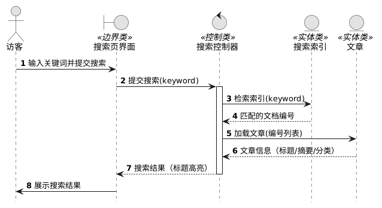

##### 图 1-6 搜索文章

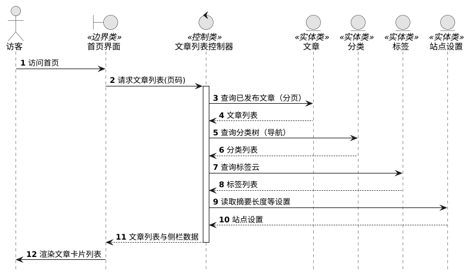

##### 图 1-7 浏览文章列表

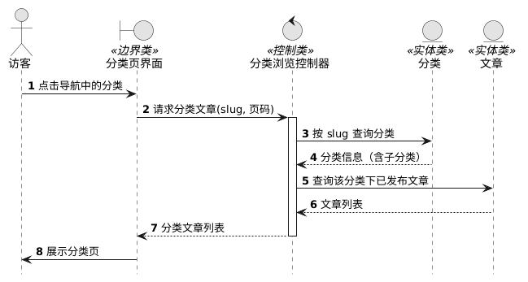

##### 图 1-8 按分类浏览

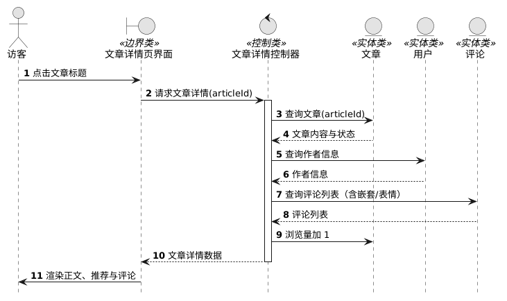

##### 图 1-9 查看文章详情

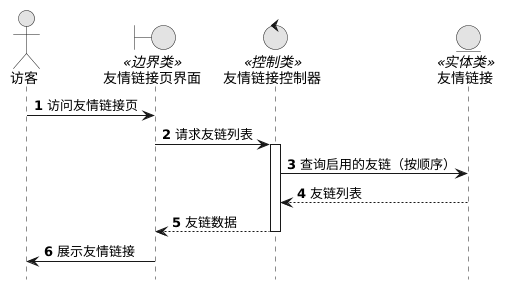

##### 图 1-10 查看友情链接

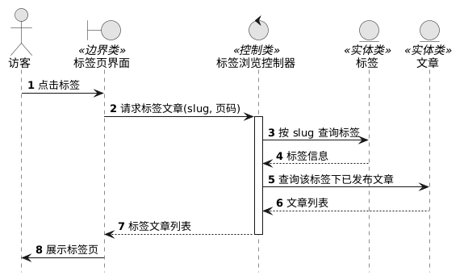

##### 图 1-11 按标签浏览

## 4 账户与登录类（U7～U13）

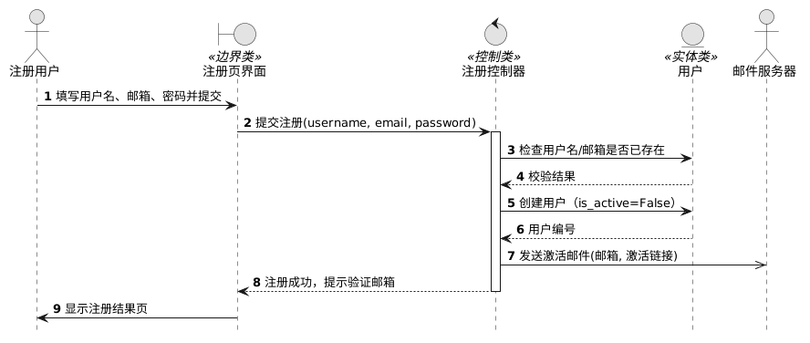

##### 图 1-12 注册

##### 图 1-13 用户登录

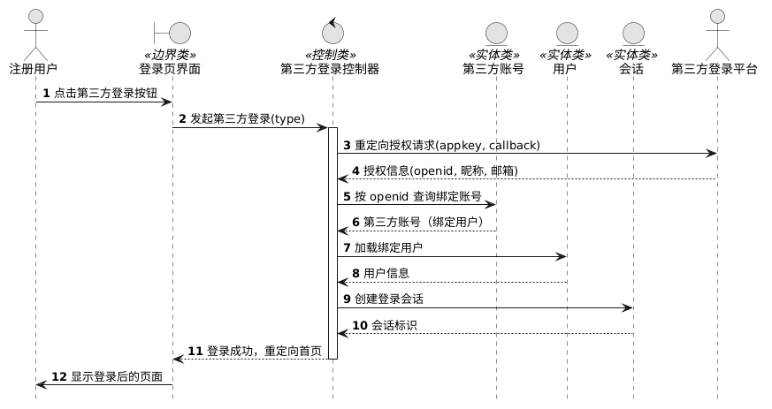

##### 图 1-14 第三方登录

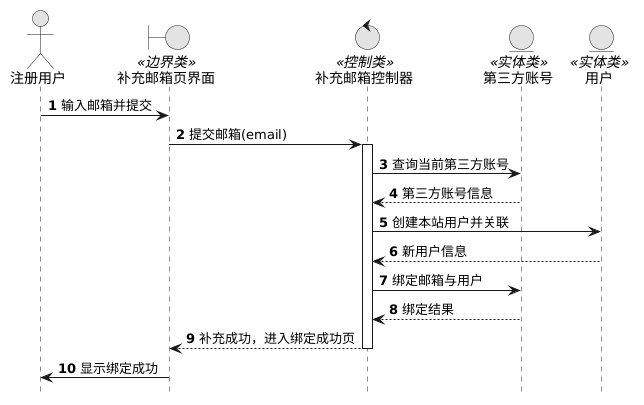

##### 图 1-15 补充邮箱

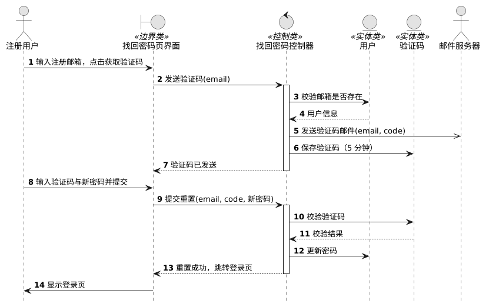

##### 图 1-16 找回密码

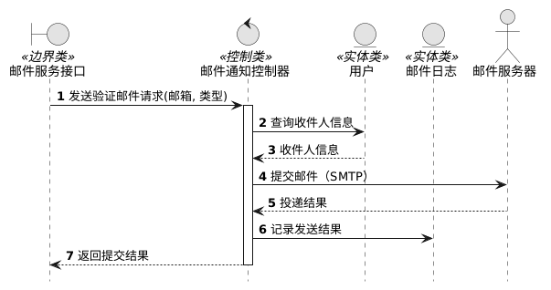

##### 图 1-17 发送验证邮件

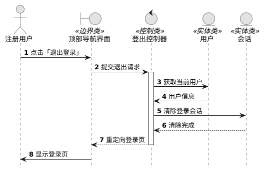

##### 图 1-18 退出登录

## 5 评论互动类（U14～U16）

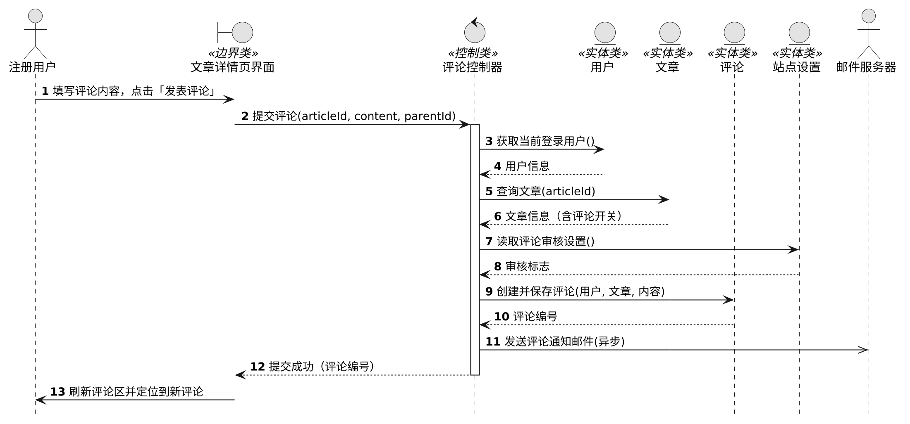

##### 图 1-19 发表评论

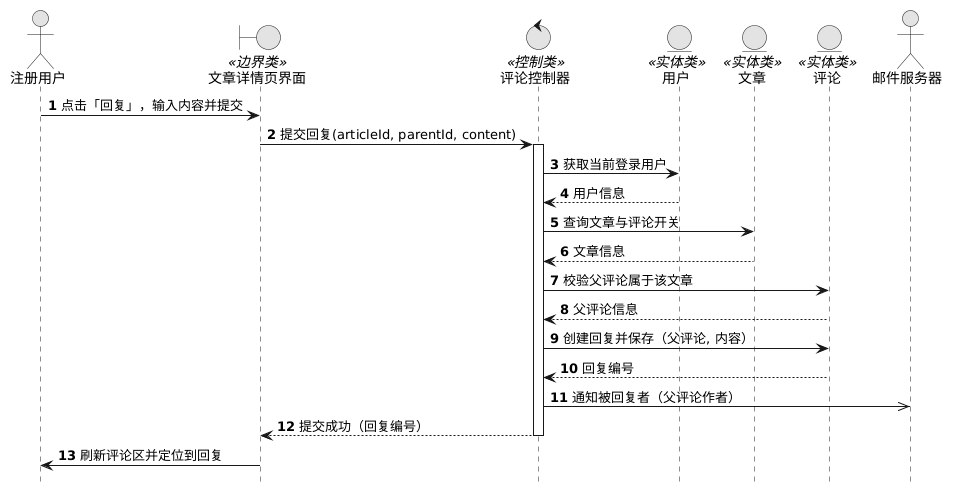

##### 图 1-20 回复评论

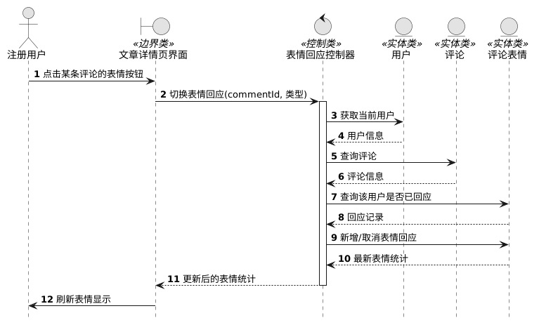

##### 图 1-21 评论表情回应

## 6 后台管理类（U17～U21）

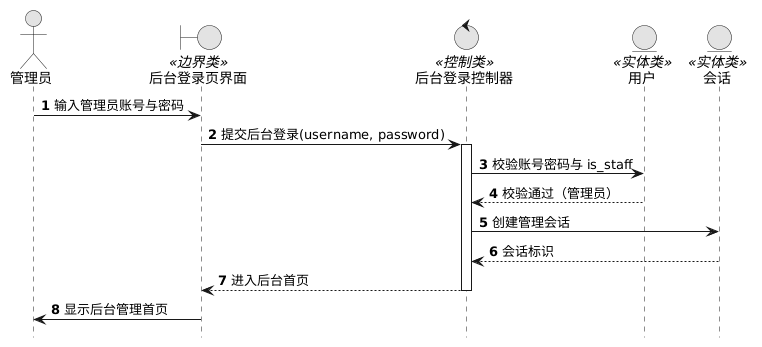

##### 图 1-22 后台登录

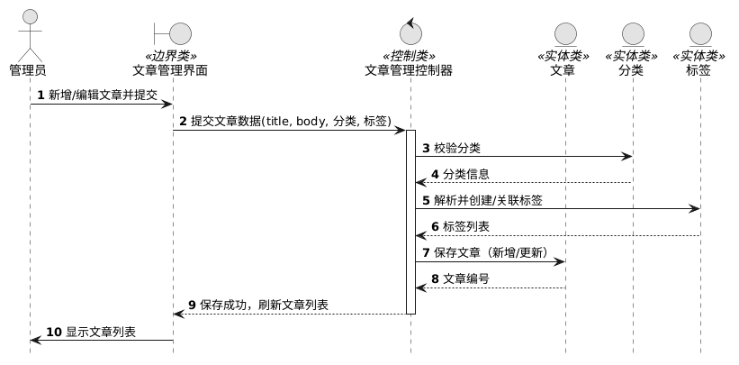

##### 图 1-23 维护文章

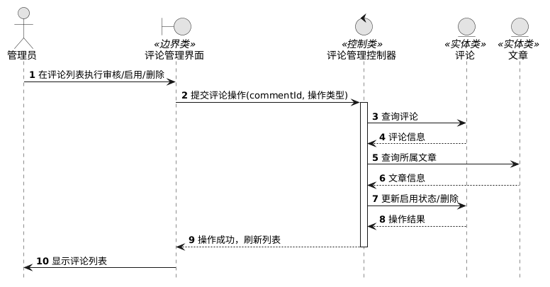

##### 图 1-24 管理评论

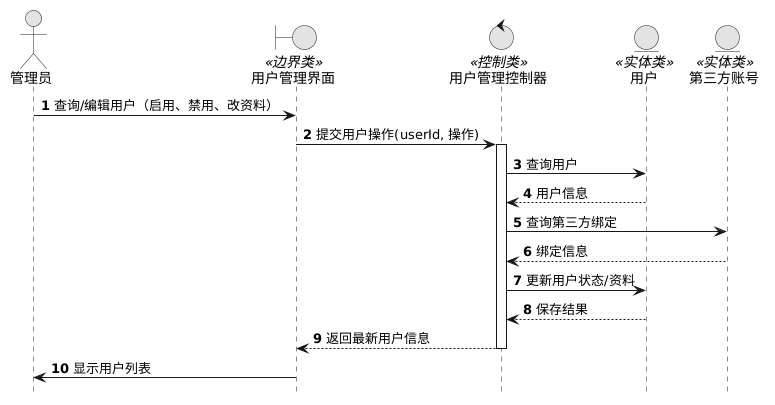

##### 图 1-25 管理用户

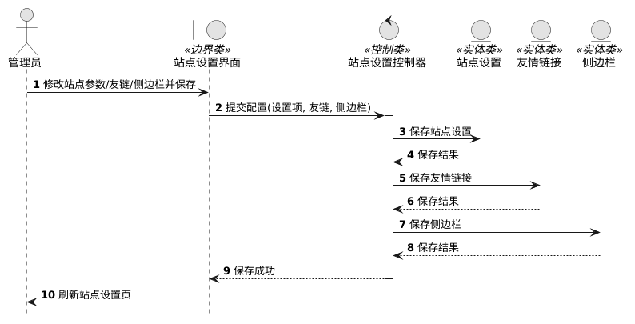

##### 图 1-26 站点设置

## 7 微信服务类（U22）

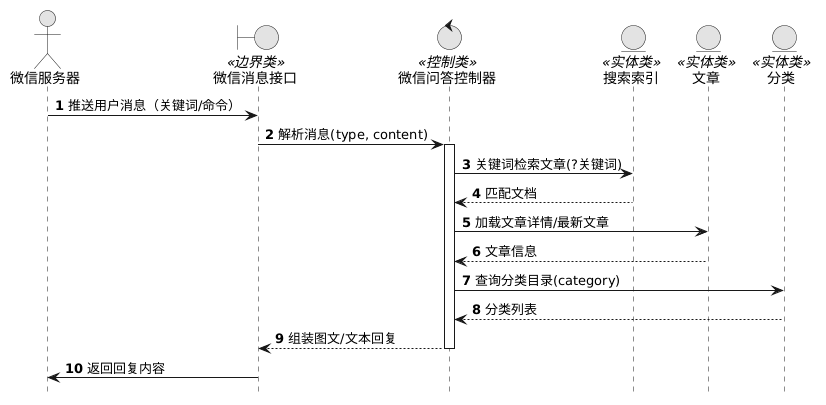

##### 图 1-27 微信问答
