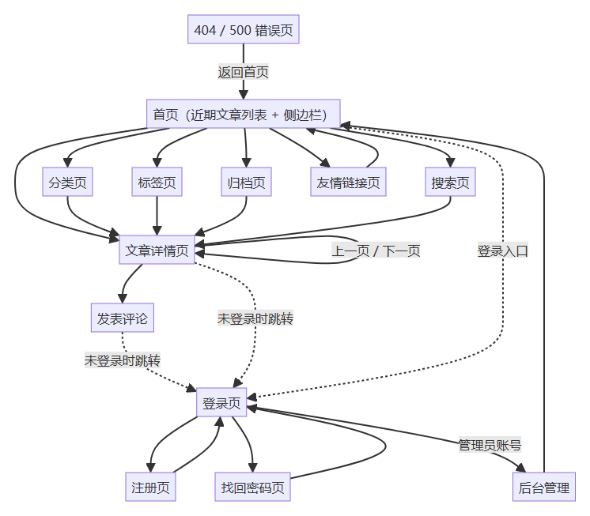
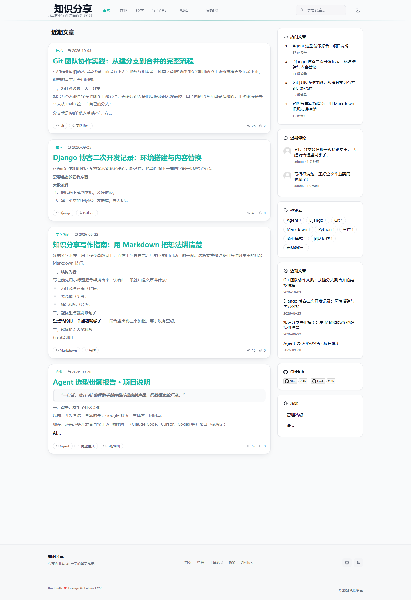
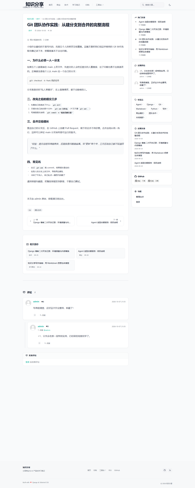
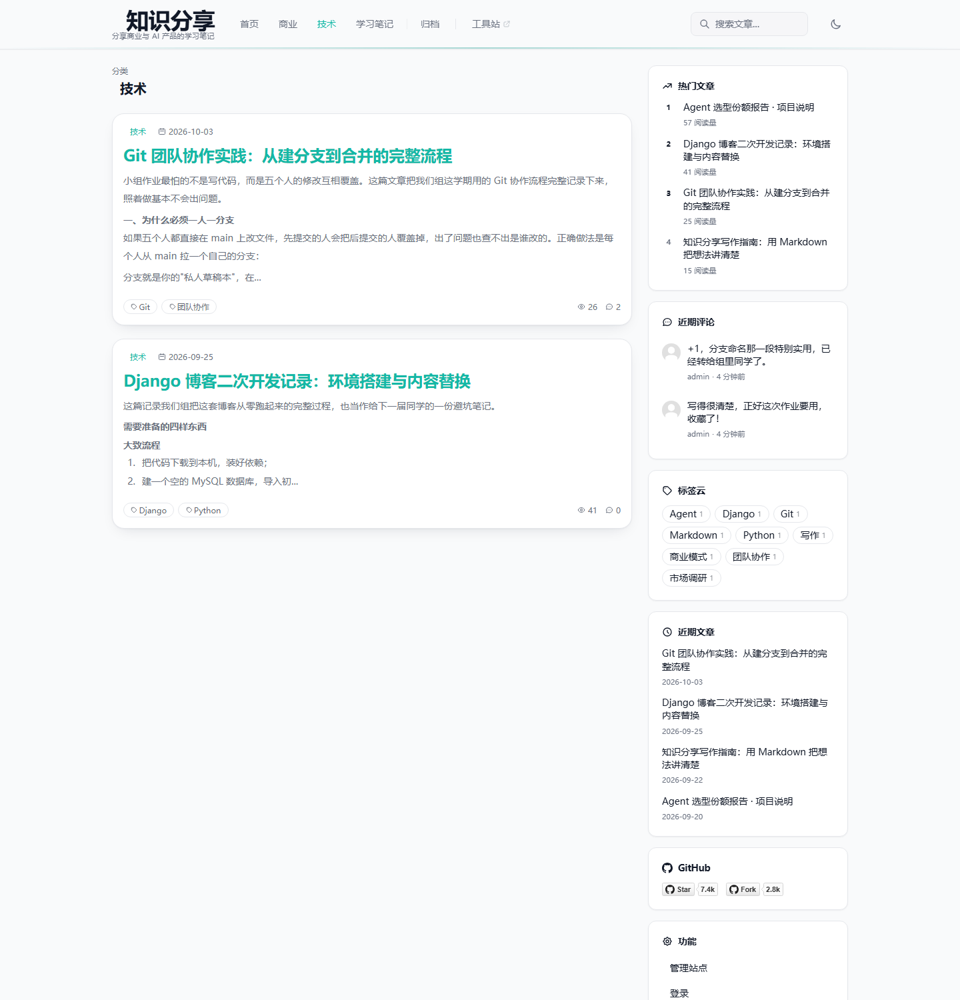
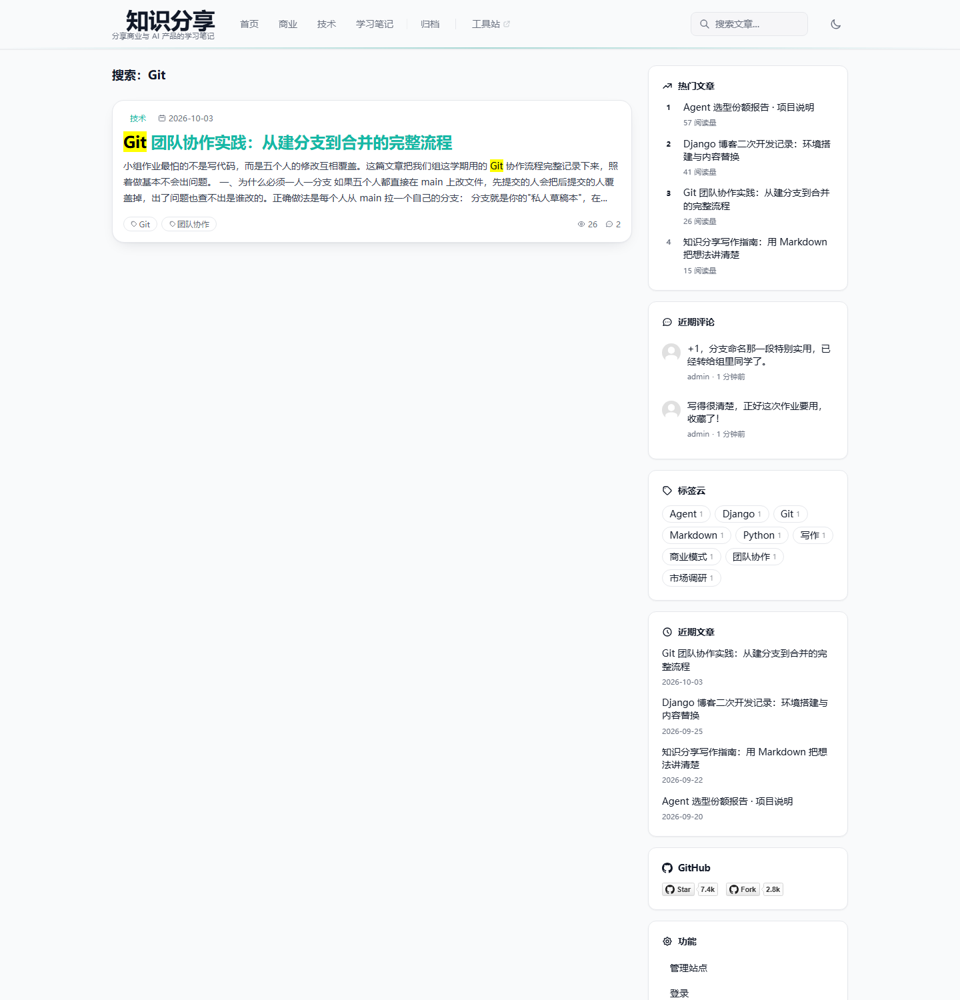
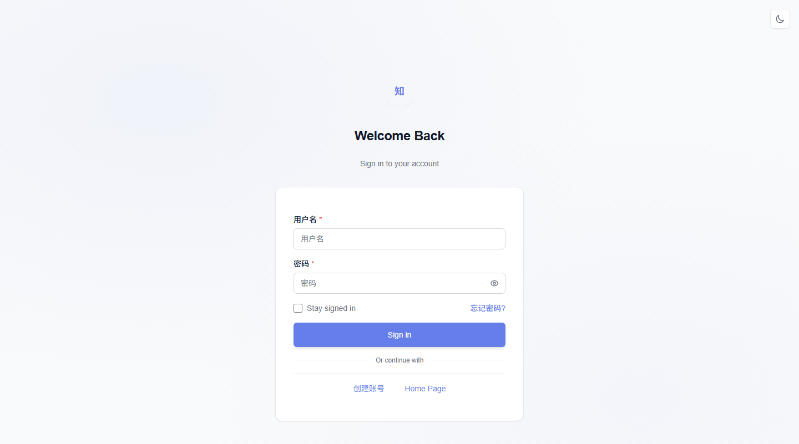
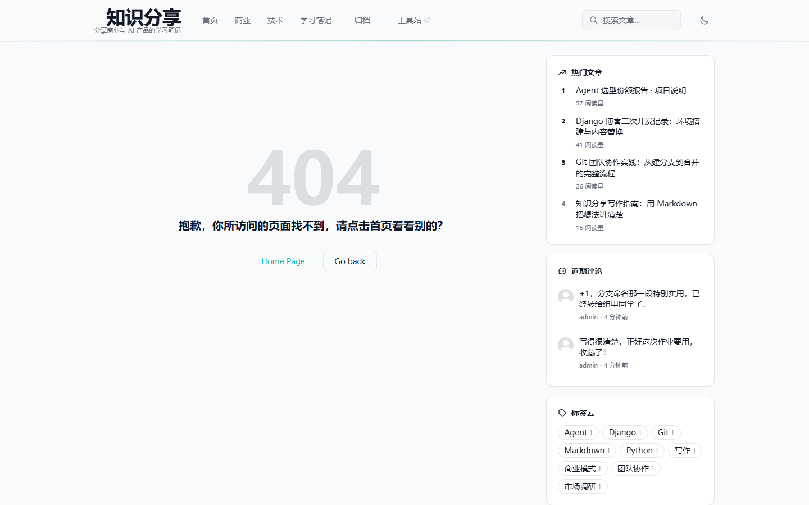

# 2 界面分析

> 本节对应模板「2 界面分析」，引入前面《界面设计说明书》的分析结果（完整版见 `doc/界面设计说明书.md`），并按本报告篇幅精选关键界面截图。

## 1 界面清单

系统共 13 个用户界面，按用途分为浏览、账户、后台与异常四类：

| 编号 | 界面名称 | 访问路径 | 主要功能 |
|---|---|---|---|
| A-01 | 首页 | `/` | 近期文章列表、分类导航、搜索框、侧边栏 |
| A-02 | 文章详情页 | `/article/年/月/日/编号.html` | 正文阅读、浏览量与相关推荐、评论区 |
| A-03 | 分类页 | `/category/分类标识.html` | 某分类下的文章列表 |
| A-04 | 标签页 | `/tag/标签标识.html` | 某标签下的文章列表 |
| A-05 | 归档页 | `/archives.html` | 按年月分组浏览全部文章 |
| A-06 | 搜索页 | `/search?q=关键词` | 站内搜索，结果标题高亮 |
| A-07 | 友情链接页 | `/links.html` | 友链列表 |
| B-01 | 登录页 | `/login/` | 账号登录与第三方登录入口 |
| B-02 | 注册页 | `/register/` | 新用户注册 |
| B-03 | 找回密码页 | `/forget_password/` | 邮箱验证码重置密码 |
| C-01 | 后台登录页 | `/admin/login/` | 后台管理入口 |
| D-01 | 404 错误页 | 任意不存在的地址 | 错误提示与返回入口 |
| E-01 | 移动端布局 | `/`（窄屏） | 响应式单栏与汉堡菜单 |

## 2 界面流转关系

##### 图 2-1 界面流转关系图

主要流转路径：

| 序号 | 来源 | 目标 | 触发方式 |
|---|---|---|---|
| 1 | 首页 | 文章详情页 | 点击文章卡片标题 |
| 2 | 首页 | 分类/标签/归档/搜索/友链页 | 顶部导航、侧栏标签云与「近期文章」 |
| 3 | 列表类页面 | 文章详情页 | 点击列表条目 |
| 4 | 文章详情页 | 文章详情页 | 上一篇/下一篇、相关推荐 |
| 5 | 文章详情页 | 标签页/分类页 | 点击标签、分类或面包屑 |
| 6 | 文章详情页 | 登录页 | 未登录时点击评论框 |
| 7 | 任意页面 | 登录页 | 侧栏「功能 → 登录」 |
| 8 | 登录页 | 注册页/找回密码页 | 表单下方链接 |
| 9 | 登录页（管理员） | 后台管理 | 「管理站点」或直接访问 `/admin/` |
| 10 | 任意错误地址 | 404 页 | 自动跳转，页内可返回 |
| 11 | 移动端任意页 | 导航抽屉 | 点击汉堡菜单 |

## 3 设计风格与响应式

1. **技术风格**：Tailwind CSS 原子类统一风格，Alpine.js 与 HTMX 提供轻量交互，图标为内联 SVG；
2. **主题**：青绿色为主色，支持明暗双主题（跟随系统或手动切换，母版内联防闪烁脚本）；
3. **布局**：桌面端为「主内容 + 右侧边栏」双栏；窄屏自动切换为单栏，导航折叠为汉堡菜单抽屉；
4. **一致性**：前台页面统一继承 `base.html`，账户页统一继承 `base_account.html`，导航、页脚、公共资源由母版提供。

## 4 关键界面截图

##### 图 2-2 首页

首页按发布时间倒序展示文章卡片（分类、日期、标题、摘要、标签、浏览量/评论数），右侧栏依次为热门文章、近期评论、标签云、近期文章与功能入口。

##### 图 2-3 文章详情页

详情页包含面包屑、标题元信息（含阅读时间插件注入）、正文、版权声明（插件注入）、标签、上下篇导航、相关推荐与嵌套评论区。

##### 图 2-4 分类页

分类页展示某分类下全部文章，布局与首页一致，支持分页与侧边栏。

##### 图 2-5 搜索页

搜索结果条目对标题中的关键词做高亮显示，无结果时给出空状态提示。

##### 图 2-6 登录页

登录页采用账户页母版：居中卡片表单（用户名、密码、记住我），下方为注册、找回密码入口与第三方登录按钮区。

##### 图 2-7 后台登录页

后台管理入口；登录后可维护文章、分类、标签、评论、用户、站点配置与第三方登录配置等数据。

##### 图 2-8 404 错误页

访问不存在的地址时显示 404 提示，并提供返回首页、返回上一页两个入口，避免用户迷失。

##### 图 2-9 移动端首页

窄屏下同一套模板切换为单栏布局，侧边栏隐藏，顶部导航折叠为汉堡菜单抽屉。

## 5 界面设计评价

**优点**：

1. 两层母版（前台/账户）覆盖全部页面，风格统一、修改一处全站生效；
2. 文章卡片、分页、侧边栏、评论等重复单元全部片段化，由包含标签按需渲染，复用度高；
3. 插件通过钩子向界面注入阅读时间、版权声明、相关推荐等功能，扩展界面无需修改页面模板；
4. 响应式与明暗主题完善，移动端可用性好。

**可改进点**：

1. 评论模板存在新旧两套（`*_modern` 与旧版），旧版已不被引用，建议清理；
2. 导航的桌面版与移动版为两份重复结构，可抽取共用片段进一步减少重复；
3. 部分插件注入内容（阅读时间、版权）缺少开关配置，建议在站点设置中提供。

> 完整分析（13 张截图、模板继承/包含关系、UML 包图）见 `doc/界面设计说明书.md`。
