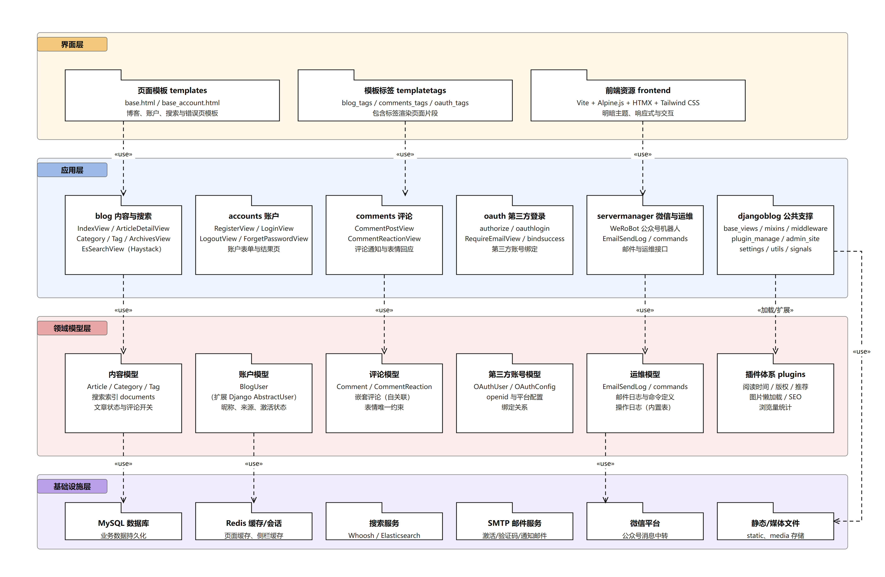

# 4 软件架构及各个包和类的作用

> 本节对应模板「4 开源软件的软件架构及各个包和类的作用」：分析各包作用与包内主要类的职责，并用 UML 包图绘制分层架构图。

## 1 分层架构图

##### 图 4-1 系统分层架构包图

架构按四层组织，层间依赖方向自上而下（界面层 → 应用层 → 领域模型层 → 基础设施层），箭头标注 «use» 表示上层使用下层提供的功能；应用层也可直接使用缓存、邮件、搜索等基础设施。

## 2 分层与包职责

| 层 | 包 | 职责 | 主要类/文件 |
|---|---|---|---|
| 界面层 | 页面模板 templates | 页面骨架与各业务页面；前台统一继承 `base.html`，账户页继承 `base_account.html` | `base.html`、`article_index.html`、`article_detail.html`、`login.html`、`registration_form.html` |
| 界面层 | 模板标签 templatetags | 以包含标签渲染页面片段（文章卡片、分页、侧栏、评论、OAuth 按钮） | `blog_tags`、`comments_tags`、`oauth_tags`、`vite_tags` |
| 界面层 | 前端资源 frontend | Vite 构建的 CSS/JS；Tailwind 样式、Alpine.js 交互、HTMX 局部刷新、明暗主题 | `frontend/` 构建产物、`vite_tags` 引用 |
| 应用层 | blog 内容与搜索 | 文章列表/详情/分类/标签/作者/归档、搜索、友情链接 | `IndexView`、`ArticleDetailView`、`CategoryDetailView`、`EsSearchView` |
| 应用层 | accounts 账户 | 注册、登录、退出、找回密码、账户结果页 | `RegisterView`、`LoginView`、`LogoutView`、`ForgetPasswordView` |
| 应用层 | comments 评论 | 评论提交与回复、表情回应 API、评论通知 | `CommentPostView`、`CommentReactionView`、`send_comment_email` |
| 应用层 | oauth 第三方登录 | OAuth 授权跳转、回调登录、补充邮箱、账号绑定 | `authorize`、`oauthlogin`、`RequireEmailView`、`bindsuccess` |
| 应用层 | servermanager 微信与运维 | 微信公众号消息处理、邮件发送日志、后台命令维护 | `robot`（WeRoBot）、`EmailSendLog`、`commands` |
| 应用层 | djangoblog 公共支撑 | 视图基类、中间件、插件管理、后台站点、配置与信号 | `base_views`、`mixins`、`middleware`、`plugin_manage`、`admin_site`、`settings` |
| 领域模型层 | 内容模型 | 文章、分类（多级）、标签、搜索索引；文章状态与评论开关 | `Article`、`Category`、`Tag`、`documents` |
| 领域模型层 | 账户模型 | 本站用户（扩展 Django 用户）、昵称、来源、激活状态 | `BlogUser` |
| 领域模型层 | 评论模型 | 评论正文、嵌套回复（自关联）、审核状态、表情反应 | `Comment`、`CommentReaction` |
| 领域模型层 | 第三方账号模型 | 第三方身份（openid）与本站用户绑定、平台接入配置 | `OAuthUser`、`OAuthConfig` |
| 领域模型层 | 运维模型 | 邮件发送日志、后台命令、操作日志 | `EmailSendLog`、`commands`、`LogEntry` |
| 领域模型层 | 插件体系 plugins | 通过钩子向内容/界面注入功能：阅读时间、版权、推荐、懒加载、SEO、浏览量 | `plugins/*/`、`plugin_manage` |
| 基础设施层 | MySQL 数据库 | 业务数据持久化（文章、用户、评论、配置等） | `dailyblog` 库 |
| 基础设施层 | Redis 缓存/会话 | 页面缓存、侧栏缓存、会话与登录状态 | `CACHES` 配置 |
| 基础设施层 | 搜索服务 | 全文检索索引（Whoosh 或 Elasticsearch）与中文分词 | Haystack、`whoosh_cn_backend`、`elasticsearch_backend` |
| 基础设施层 | SMTP 邮件服务 | 注册激活、找回密码验证码、评论通知邮件 | `send_email`、`EmailSendLog` |
| 基础设施层 | 微信平台 | 公众号消息中转（用户消息与自动回复） | WeRoBot、`servermanager.robot` |
| 基础设施层 | 静态/媒体文件 | 静态资源、上传图片与媒体文件 | `collectedstatic`、`media` |

## 3 主要类职责

| 类/模块 | 所在包 | 职责 |
|---|---|---|
| `IndexView` | blog | 首页文章列表（分页、缓存、侧栏数据） |
| `ArticleDetailView` | blog | 文章详情、浏览量统计、相关推荐与评论展示 |
| `CategoryDetailView` / `TagDetailView` / `AuthorDetailView` | blog | 分类/标签/作者维度的文章列表 |
| `ArchivesView` | blog | 按年月分组的归档页 |
| `EsSearchView` | blog | 站内搜索（Haystack 检索、标题高亮） |
| `LinkListView` | blog | 友情链接页 |
| `RegisterView` | accounts | 注册：创建未激活用户并发送激活邮件 |
| `LoginView` | accounts | 登录：校验账号密码、创建会话（记住我延长有效期） |
| `LogoutView` | accounts | 退出：清除会话与登录标记 |
| `ForgetPasswordView` / `ForgetPasswordEmailCode` | accounts | 找回密码：发送验证码、校验并重置密码 |
| `CommentPostView` | comments | 评论/回复：登录与评论开关校验、保存、通知 |
| `CommentReactionView` | comments | 表情回应：查询统计、切换单个表情 |
| `authorize` / `oauthlogin` | oauth | 第三方登录：授权跳转与回调登录 |
| `RequireEmailView` | oauth | 第三方注册缺少邮箱时补充邮箱 |
| `SecureFormView` / `LoginFormView` / `AuthenticatedFormView` | djangoblog | 视图基类：CSRF、表单、登录校验等通用逻辑 |
| `DjangoBlogAdminSite` | djangoblog | 后台管理站点：注册文章/评论/用户/配置等模型管理类 |
| `ArticlelAdmin` / `CategoryAdmin` / `TagAdmin` | blog | 后台维护文章、分类、标签 |
| `BlogSettingsAdmin` / `LinksAdmin` / `SideBarAdmin` | blog | 后台维护站点设置、友链、侧边栏（含评论审核开关） |
| `CommentAdmin` / `CommentReactionAdmin` | comments | 后台审核/启用/删除评论，管理表情回应 |
| `BlogUserAdmin` | accounts | 后台用户管理（启用/禁用、资料维护） |
| `OAuthUserAdmin` / `OAuthConfigAdmin` | oauth | 后台第三方账号与登录平台配置管理 |
| `EmailSendLogAdmin` / `CommandsAdmin` | servermanager | 后台查看邮件日志、维护可执行命令 |
| `robot`（WeRoBot） | servermanager | 微信问答：关键词检索文章、分类/最新文章、智能回复 |
| `send_email` + 信号 | djangoblog | 统一邮件发送入口（异步、记录日志） |
| `plugin_manage` + `plugins/*` | djangoblog / plugins | 插件注册与钩子调用（内容注入、推荐、SEO 等） |

## 4 架构特点

1. **分层清晰**：界面层只负责展示与交互，应用层集中业务编排，领域模型层封装数据与约束，基础设施层提供数据库、缓存、搜索、邮件、微信等能力；
2. **公共支撑复用**：`djangoblog` 提供视图基类、中间件、插件管理与后台站点，各应用复用同一套安全与表单处理逻辑；
3. **插件化扩展**：`plugins` 通过钩子在内容与界面中注入功能（阅读时间、版权、推荐、懒加载、SEO、浏览量），新增功能不必改动页面模板；
4. **数据与检索分离**：关系数据存 MySQL，全文检索走 Haystack + Whoosh/Elasticsearch，索引由文章保存信号实时更新；
5. **横切能力下沉**：邮件、缓存、日志以工具/信号形式供各应用调用，避免重复实现。

## 5 与数据流图、数据模型的对应

| 架构层 | 数据流图加工 | 数据存储/模型 |
|---|---|---|
| 应用层（blog / accounts / comments / oauth / servermanager） | P1 用户与权限管理、P2 内容浏览与搜索、P3 评论互动、P4 后台管理、P5 通知服务、P6 微信问答 | 通过领域模型读写 D1～D5 |
| 领域模型层 | — | 15 个实体（第 3 章类图） |
| 基础设施层 | — | MySQL（D1～D5）、Redis、搜索索引、SMTP、微信平台 |
