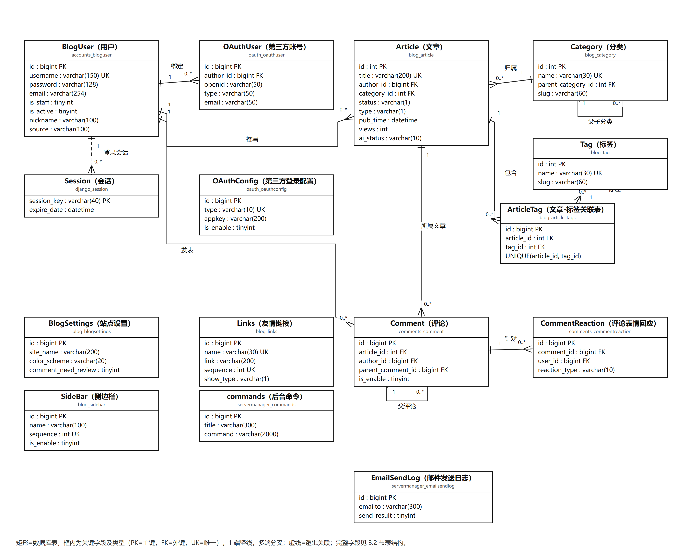
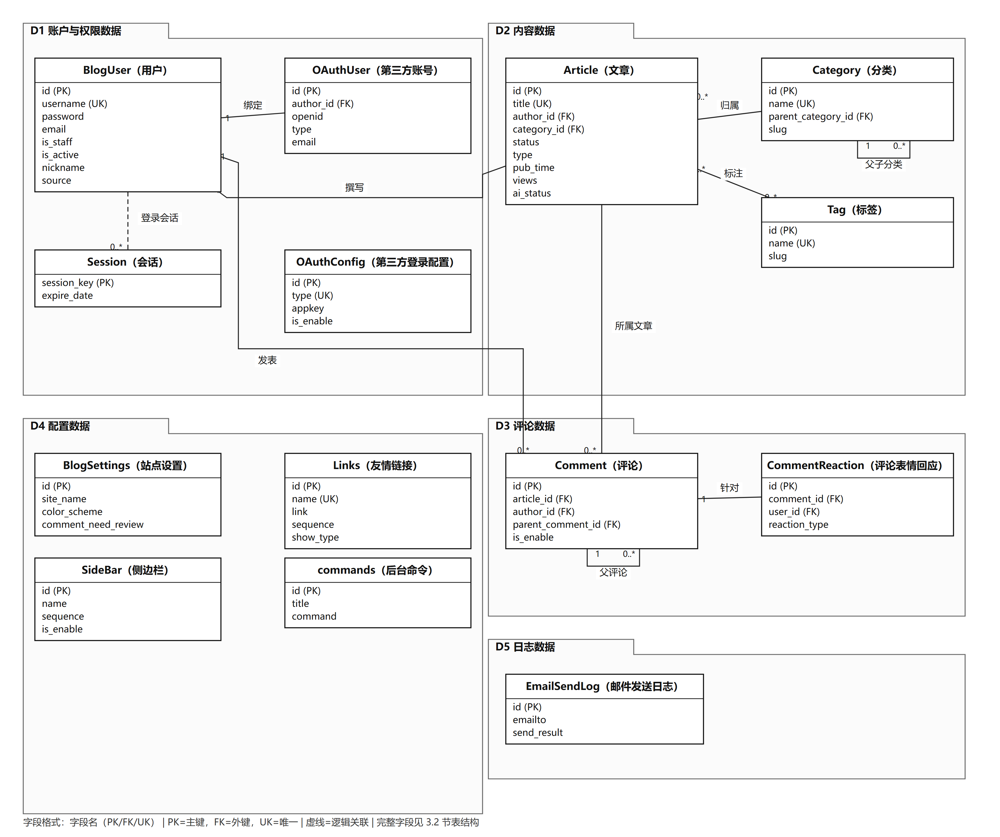

# 「知识分享」博客系统的数据模型设计

组号：第 13 组

小组成员：丁昊、席佳宁、朱宇豪、何君杰、李子涵

## 1 软件系统概述

「知识分享」博客系统是在开源项目 DjangoBlog 基础上二次开发的知识分享平台。它要解决的问题可以概括为：让内容创作者能够发布、组织和维护文章，让读者能够浏览、检索和互动，让管理员能够配置站点并审计运行情况。系统在原有博客能力上补充了站内主题数据、界面定制、评论表情回应、AI 导读字段与站内问答等能力（站内问答的检索与页面实现目前在开发分支 D_branch，尚未合入 main）。

系统采用 Django 5.2 + MySQL 作为主数据存储；缓存默认使用 Django 本地内存（配置 DJANGO_REDIS_URL 后可切换 Redis）；全文检索默认使用 Whoosh，可通过环境变量切换 Elasticsearch；前端由 Vite + Tailwind CSS + Alpine.js 构建。业务代码分为 accounts（账户）、blog（内容）、comments（评论）、oauth（第三方登录）、servermanager（运维）五个应用，另有 djangoblog 公共配置与 AI 客户端。

从数据视角看，系统围绕五类数据组织：账户与权限（D1）、内容（D2）、评论（D3）、配置（D4）、日志（D5）。本文档分析这五类数据对应的 13 个业务 model、Django 会话辅助表和文章—标签中间表，给出 E-R 图、UML 类图、表结构、model 对应关系与主要约束。

> 注：建模依据：线上 main 分支 commit 81f2d69 的 models.py（与本地 D_branch 的数据模型一致）。Django 内置的 auth_group、auth_permission、django_admin_log、django_site 等框架表属于基础设施，不在正文展开；BlogUser 的 groups、user_permissions 两个多对多字段只在关系表中说明。字段类型按 MySQL 实际迁移类型标注。文中代码位置以 main 为准；D_branch 独有的 AI 问答实现会单独标注为“开发分支”。

## 2 功能与数据分析

按用户可见的主要功能归纳为 6 类。表 2-1 给出每类功能包含的子功能、处理的主要数据对象和对应代码；表 2-2 进一步给出数据对象与功能之间的读写关系。

**表 2-1 主要功能与数据对象**

| 序号 | 主要功能 | 包含的子功能 | 主要数据对象 | 对应代码 |
| --- | --- | --- | --- | --- |
| 1 | 内容浏览与检索 | 首页文章列表、分页、文章详情、按分类浏览、按标签浏览、按作者浏览、时间归档、站内搜索、友情链接 | Article、Category、Tag、BlogUser、Links；搜索索引（Whoosh，派生结构） | blog.views、djangoblog/urls.py（search） |
| 2 | 账户与认证 | 注册、登录、退出登录、找回密码、第三方登录、补充邮箱 | BlogUser、OAuthUser、OAuthConfig、Session、EmailSendLog | accounts.views、oauth.views |
| 3 | 评论互动 | 发表评论、回复评论、评论表情回应、评论审核与显示 | Comment、CommentReaction、Article、BlogUser、BlogSettings | comments.views、comments.forms |
| 4 | 内容与站点管理 | 文章管理、分类/标签管理、友链/侧边栏管理、站点设置、评论管理、用户管理、第三方账号与配置管理 | 全部 13 个业务 model | 各应用 admin.py、djangoblog.admin_site |
| 5 | 运维与通知 | 邮件发送与日志、后台命令维护、微信问答 | EmailSendLog、commands、Article、Category | servermanager.models、servermanager.robot |
| 6 | AI 导读与站内问答 | 文章 AI 摘要/要点/受众/关键词生成与状态维护、站内问答检索与引用 | Article（AI 字段）、Comment（问答索引）、Whoosh 索引 | djangoblog.ai.client（main）；站内问答在 D_branch |

### 2.1 主要功能说明

（1）内容浏览与检索。这是读者侧读多写少的路径：首页、分页、文章详情、分类、标签、作者页和时间归档直接读取 Article、Category、Tag、BlogUser；站内搜索通过 Whoosh 索引读取 Article 的标题和正文；友情链接读取 Links。该功能除文章浏览量自增外不修改业务表。

（2）账户与认证。注册写 BlogUser，并发送激活邮件、写 EmailSendLog；登录读写 Session；第三方登录读写 OAuthUser 与 OAuthConfig，未绑定用户先走补充邮箱流程；找回密码更新 BlogUser 的密码字段并写邮件日志。

（3）评论互动。发表评论/回复写 Comment，表情回应写 CommentReaction；展示评论时读 Article、BlogUser 和 BlogSettings（comment_need_review 控制审核）；审核动作更新 Comment.is_enable。Comment 通过 parent_comment_id 自关联保存回复层级，CommentReaction 通过联合唯一约束防止重复表情。

（4）内容与站点管理。后台对 13 个业务 model 做增删改查：文章管理写 Article 及其标签关联，分类/标签管理写 Category/Tag，站点设置写 BlogSettings，友链/侧边栏写 Links/SideBar，用户与第三方配置写 BlogUser/OAuthUser/OAuthConfig，评论管理写 Comment，运维配置写 commands/EmailSendLog。

（5）运维与通知。邮件发送写 EmailSendLog；后台命令维护写 commands；微信问答读取 commands、Article、Category，把文章卡片和分类列表返回给微信用户。该功能不新增业务表，主要复用内容与配置数据。

（6）AI 导读与站内问答。AI 导读把生成结果写回 Article 的 ai_summary、ai_highlights、ai_audience、ai_keywords、ai_status、ai_generated_at、ai_model 字段；站内问答读取 Article 的 AI 字段和 Comment 的索引内容，返回带引用的回答。该功能不新增表，AI 结果作为 Article 的扩展属性保存。需要说明的是：AI 字段与 djangoblog.ai.client 已随 main@81f2d69 合入；站内问答的检索、接口和页面实现目前只在开发分支 D_branch，尚未合入 main。

**表 2-2 数据对象与主要功能的读写关系**

| 数据对象 | 内容浏览 | 账户认证 | 评论互动 | 内容管理 | 运维通知 | AI 导读 |
| --- | --- | --- | --- | --- | --- | --- |
| BlogUser | ○ | ● | ○ | ● |  |  |
| OAuthUser |  | ● |  | ● |  |  |
| OAuthConfig |  | ○ |  | ● |  |  |
| Session | ○ | ● |  |  |  |  |
| Article | ○ |  | ○ | ● | ○ | ● |
| Category | ○ |  |  | ● | ○ |  |
| Tag | ○ |  |  | ● |  |  |
| blog_article_tags | ○ |  |  | ● |  |  |
| Comment |  |  | ● | ● |  | ○ |
| CommentReaction |  |  | ● | ● |  |  |
| BlogSettings |  | ○ | ○ | ● |  |  |
| Links | ○ |  |  | ● |  |  |
| SideBar | ○ |  |  | ● |  |  |
| commands |  |  |  | ● | ● |  |
| EmailSendLog |  | ● |  | ○ | ● |  |

> 注：● 表示该功能会写入该数据对象，○ 表示只读，空白表示不涉及。矩阵按主要读写路径归纳，不排除个别辅助查询；Whoosh 索引是派生结构，未单列。

## 3 数据模型设计

数据模型设计分三层表达：E-R 图回答“有哪些表、表之间是什么关系、重数多少”；UML 类图回答“代码里有哪些 model、关键属性是什么”；3.2 节的表结构给出每个字段的类型、主键、外键和约束。两张图都只画关键字段，完整字段以表结构为准，避免图面因字段过多而不可读。

E-R 图采用 Crow's Foot 记法：矩形为数据库表，框内列关键字段及类型；1 端画竖线，多端画分叉；虚线表示没有数据库外键的逻辑关联。类图采用 UML 类图记法：包对应数据域，类名为 model 类名，字段格式为“字段名（PK/FK/UK）”。

### 3.1 实体关系与数据模型图

实体之间的主要关系汇总见表 3-1。重数按“左端 : 右端”书写；可选性说明外键是否允许为空；实现方式给出数据库外键、中间表或逻辑关联。

**表 3-1 实体关系说明**

| 关系名 | 参与实体 | 重数 | 可选性 | 实现方式 | 说明 |
| --- | --- | --- | --- | --- | --- |
| 绑定 | BlogUser — OAuthUser | 1:0..* | OAuthUser.author 可空 | FK oauth_oauthuser.author_id | 一个本站用户可绑定多个第三方账号；author 为空表示尚未绑定。 |
| 使用配置 | OAuthConfig — OAuthUser | 1:0..* | 按 type 逻辑关联，无外键 | OAuthUser.type = OAuthConfig.type | 每个第三方平台一条配置；OAuthUser 按 type 使用对应配置，属逻辑关联。 |
| 登录会话 | BlogUser — Session | 1:0..* | 逻辑关联 | session_data 中保存用户标识 | 一个用户可有多个登录会话，支持多端登录；“记住我”延长 expire_date。 |
| 撰写 | BlogUser — Article | 1:0..* | Article.author_id 非空 | FK blog_article.author_id | 一个用户可写多篇文章，每篇文章必有一个作者。 |
| 归属 | Category — Article | 1:0..* | Article.category_id 非空 | FK blog_article.category_id | 一个分类可有多篇文章，每篇文章必须属于一个分类。 |
| 父子分类 | Category — Category | 1:0..* | parent_category_id 可空 | FK blog_category.parent_category_id（自关联） | 父分类可挂多个子分类；为空表示顶级分类，支持多级分类树。 |
| 标注 | Article — Tag | 0..*:0..* | 标签可为空 | M2M blog_article_tags(article_id, tag_id) | 一篇文章多个标签，一个标签多篇文章；中间表联合唯一防重复。 |
| 发表 | BlogUser — Comment | 1:0..* | Comment.author_id 非空 | FK comments_comment.author_id | 一个用户可发表多条评论，每条评论必有一个作者。 |
| 所属文章 | Article — Comment | 1:0..* | Comment.article_id 非空 | FK comments_comment.article_id | 一篇文章可有多条评论，每条评论必须属于一篇文章。 |
| 父评论 | Comment — Comment | 1:0..* | parent_comment_id 可空 | FK comments_comment.parent_comment_id（自关联） | 为空是顶级评论，非空是对某条评论的回复；支持无限层级嵌套。 |
| 针对 | Comment — CommentReaction | 1:0..* | CommentReaction.comment_id 非空 | FK comments_commentreaction.comment_id | 一条评论可有多种表情回应。 |
| 回应 | BlogUser — CommentReaction | 1:0..* | CommentReaction.user_id 非空 | FK comments_commentreaction.user_id | 一个用户可对多条评论回应；同用户同评论同表情唯一。 |
| 权限关联 | BlogUser — auth_group / auth_permission | 0..* : 0..* | 框架表 | M2M accounts_bloguser_groups / accounts_bloguser_user_permissions | 用户通过 Django 权限体系获得后台权限；属框架表，本文档不展开。 |

在表 3-1 的关系基础上，图 3-1 用 Crow's Foot 记法给出数据库表及重数，图 3-2 用 UML 类图给出 model 类与关键属性。两张图均排在横向页上，图后回到纵向页继续表结构。

### 3.1.1 关系设计说明

（1）结构关系。一对多关系由“多”端外键实现：BlogUser→Article/Comment/CommentReaction、Article→Comment、Comment→CommentReaction、Category→Article；多对多 Article↔Tag 由 blog_article_tags 中间表实现，并对 (article_id, tag_id) 联合唯一；Category.parent_category_id、Comment.parent_comment_id 为自关联，分别形成分类树和回复树。

（2）逻辑关系。BlogUser↔Session 通过 session_data 关联，OAuthConfig↔OAuthUser 通过 type 关联；两者没有数据库外键，重数与一致性由应用层保证。

图 3-1 数据模型 E-R 图

> 注：图中只列主键、外键、唯一键和关键业务字段；Article 与 Tag 的多对多通过中间表 blog_article_tags 显式表示。为避免连线交叉，OAuthConfig—OAuthUser 的按 type 逻辑关联、BlogUser—CommentReaction 的回应关系以及权限关联未在图中画出，完整关系见表 3-1。

图 3-2 数据模型 UML 类图

> 注：类图按五个数据域分包，只列关键属性；完整字段见 3.2 节表结构。与图 3-1 相同，OAuthConfig—OAuthUser、BlogUser—CommentReaction 和权限关联未在图中画出，完整关系见表 3-1。

### 3.2 实体表结构

下列表结构按数据库实际列列出，包含继承字段：Article、Category、Tag 继承 BaseModel 的 id、creation_time、last_modify_time；BlogUser 继承 AbstractUser 的 password、last_login、is_superuser、username、first_name、last_name、email、is_staff、is_active、date_joined。

两个容易对错的地方：BlogUser 的实际表名是 accounts_bloguser（不是 auth_user）；Links、SideBar 的修改时间字段是 last_mod_time（不是 last_modify_time）。groups、user_permissions 属 Django 权限框架表，不列入 accounts_bloguser 的列，详见关系表 3-1 的“权限关联”行。

### 3.2.1 账户与权限数据（D1）

**表 3-2 用户表 BlogUser（accounts_bloguser）**

| 字段名 | 中文名 | 类型 | 约束/取值 | 说明 |
| --- | --- | --- | --- | --- |
| id | 用户编号 | bigint | PK，自增 | 主键 |
| password | 密码 | varchar(128) | 非空 | Django 密码哈希，不存明文 |
| last_login | 最后登录时间 | datetime(6) | 可空 | 最近一次登录时间 |
| is_superuser | 超级用户 | tinyint(1) | 非空，默认 0 | 拥有全部权限标记 |
| username | 用户名 | varchar(150) | UK，非空 | 登录名，全局唯一 |
| first_name | 名 | varchar(150) | 可空 | AbstractUser 标准字段 |
| last_name | 姓 | varchar(150) | 可空 | AbstractUser 标准字段 |
| email | 邮箱 | varchar(254) | 可空 | 激活邮件、评论通知的收件地址 |
| is_staff | 后台权限 | tinyint(1) | 非空，默认 0 | 是否允许进入 admin 后台 |
| is_active | 是否激活 | tinyint(1) | 非空，默认 1 | 邮箱验证前由注册视图置 0 |
| date_joined | 注册时间 | datetime(6) | 非空 | AbstractUser 标准字段 |
| nickname | 昵称 | varchar(100) | 可空 | 前台作者信息展示名 |
| creation_time | 创建时间 | datetime(6) | 非空 | 业务扩展字段 |
| last_modify_time | 修改时间 | datetime(6) | 非空 | 业务扩展字段 |
| source | 注册来源 | varchar(100) | 可空 | Register、adminsite 等渠道标识 |

**表 3-3 第三方账号表 OAuthUser（oauth_oauthuser）**

| 字段名 | 中文名 | 类型 | 约束/取值 | 说明 |
| --- | --- | --- | --- | --- |
| id | 编号 | bigint | PK，自增 | 主键 |
| author_id | 绑定用户 | bigint | FK→accounts_bloguser.id，可空 | 为空表示尚未绑定 |
| openid | 第三方标识 | varchar(50) | 非空 | 平台返回的用户 ID |
| nickname | 第三方昵称 | varchar(50) | 非空 | 平台昵称 |
| token | 访问令牌 | varchar(150) | 可空 | 第三方 access token |
| picture | 头像地址 | varchar(350) | 可空 | 第三方头像 URL |
| type | 平台类型 | varchar(50) | 非空 | github、weibo、qq 等 |
| email | 第三方邮箱 | varchar(50) | 可空 | 可能缺失，需走补充邮箱流程 |
| metadata | 原始信息 | longtext | 可空 | 平台返回的扩展 JSON/文本 |
| creation_time | 创建时间 | datetime(6) | 非空 | 首次授权时间 |
| last_modify_time | 修改时间 | datetime(6) | 非空 | 最近同步时间 |

**表 3-4 第三方登录配置表 OAuthConfig（oauth_oauthconfig）**

| 字段名 | 中文名 | 类型 | 约束/取值 | 说明 |
| --- | --- | --- | --- | --- |
| id | 编号 | bigint | PK，自增 | 主键 |
| type | 平台类型 | varchar(10) | 非空，默认 'a'（历史遗留）； 取值 weibo/google/ github/facebook/qq | 平台标识；clean() 保证唯一 |
| appkey | AppKey | varchar(200) | 非空 | 平台分配的应用 Key |
| appsecret | AppSecret | varchar(200) | 非空 | 平台分配的应用密钥 |
| callback_url | 回调地址 | varchar(200) | 非空，默认空串 | OAuth 授权回调 URL |
| is_enable | 是否启用 | tinyint(1) | 非空，默认 1 | 关闭后登录页不显示该入口 |
| creation_time | 创建时间 | datetime(6) | 非空 | 配置创建时间 |
| last_modify_time | 修改时间 | datetime(6) | 非空 | 配置修改时间 |

**表 3-5 会话表 Session（django_session）**

| 字段名 | 中文名 | 类型 | 约束/取值 | 说明 |
| --- | --- | --- | --- | --- |
| session_key | 会话键 | varchar(40) | PK | 浏览器 Cookie 中保存的会话标识 |
| session_data | 会话数据 | longtext | 非空 | 编码后的会话内容，含用户标识 |
| expire_date | 过期时间 | datetime(6) | 非空 | 会话失效时间 |

> 注：（表 3-5）Django 内置表，不是业务 model；本文档将其作为登录会话的辅助实体列出。

### 3.2.2 内容数据（D2）

**表 3-6 文章表 Article（blog_article）**

| 字段名 | 中文名 | 类型 | 约束/取值 | 说明 |
| --- | --- | --- | --- | --- |
| id | 文章编号 | int | PK，自增 | 主键 |
| creation_time | 创建时间 | datetime(6) | 非空 | 继承自 BaseModel |
| last_modify_time | 修改时间 | datetime(6) | 非空 | 继承自 BaseModel |
| title | 标题 | varchar(200) | UK，非空 | 文章标题，全局唯一 |
| body | 正文 | longtext | 非空 | Markdown 源文 |
| pub_time | 发布时间 | datetime(6) | 非空 | 默认当前时间 |
| status | 状态 | varchar(1) | 非空，默认 'p' | d=草稿，p=已发布 |
| comment_status | 评论开关 | varchar(1) | 非空，默认 'o' | o=开放，c=关闭 |
| type | 内容类型 | varchar(1) | 非空，默认 'a' | a=文章，p=独立页面 |
| views | 浏览量 | int unsigned | 非空，默认 0 | 阅读计数 |
| author_id | 作者 | bigint | FK→accounts_bloguser.id，非空 | 文章作者 |
| article_order | 排序 | int | 非空，默认 0 | 置顶/排序值，越大越靠前 |
| show_toc | 显示目录 | tinyint(1) | 非空，默认 0 | 详情页是否显示目录 |
| category_id | 分类 | int | FK→blog_category.id，非空 | 每篇文章必须属于一个分类 |
| ai_summary | AI 摘要 | longtext | 非空，默认空串 | AI 生成的文章导读摘要 |
| ai_highlights | AI 要点 | json | 非空，默认 [] | AI 提取的要点数组 |
| ai_audience | AI 受众 | longtext | 非空，默认空串 | AI 判断的目标读者 |
| ai_keywords | AI 关键词 | json | 非空，默认 [] | AI 提取的关键词数组 |
| ai_status | AI 状态 | varchar(10) | 非空，默认 'pending' | pending/done/failed/stale |
| ai_generated_at | AI 生成时间 | datetime(6) | 可空 | 最近一次生成成功的时间 |
| ai_model | AI 模型名 | varchar(50) | 非空，默认空串 | 生成时使用的模型标识 |

> 注：（表 3-6）tags 为多对多字段，经 blog_article_tags 关联 blog_tag；不是 blog_article 的列。

**表 3-7 分类表 Category（blog_category）**

| 字段名 | 中文名 | 类型 | 约束/取值 | 说明 |
| --- | --- | --- | --- | --- |
| id | 分类编号 | int | PK，自增 | 主键 |
| creation_time | 创建时间 | datetime(6) | 非空 | 继承自 BaseModel |
| last_modify_time | 修改时间 | datetime(6) | 非空 | 继承自 BaseModel |
| name | 分类名 | varchar(30) | UK，非空 | 分类名称，全局唯一 |
| parent_category_id | 父分类 | int | FK→blog_category.id，可空 | 为空表示顶级分类 |
| slug | URL 别名 | varchar(60) | 非空，默认 'no-slug' | save() 时按名称自动生成 |
| index | 排序 | int | 非空，默认 0 | 分类展示顺序 |

**表 3-8 标签表 Tag（blog_tag）**

| 字段名 | 中文名 | 类型 | 约束/取值 | 说明 |
| --- | --- | --- | --- | --- |
| id | 标签编号 | int | PK，自增 | 主键 |
| creation_time | 创建时间 | datetime(6) | 非空 | 继承自 BaseModel |
| last_modify_time | 修改时间 | datetime(6) | 非空 | 继承自 BaseModel |
| name | 标签名 | varchar(30) | UK，非空 | 标签名称，全局唯一 |
| slug | URL 别名 | varchar(60) | 非空，默认 'no-slug' | save() 时按名称自动生成 |

> 注：（表 3-8）article 是 Article.tags 的反向多对多关系，不是 blog_tag 的列。

**表 3-9 文章—标签关联表 blog_article_tags**

| 字段名 | 中文名 | 类型 | 约束/取值 | 说明 |
| --- | --- | --- | --- | --- |
| id | 关联编号 | bigint | PK，自增 | 主键 |
| article_id | 文章 | int | FK→blog_article.id，非空 | 关联文章 |
| tag_id | 标签 | int | FK→blog_tag.id，非空 | 关联标签；与 article_id 联合唯一 |

### 3.2.3 评论数据（D3）

**表 3-10 评论表 Comment（comments_comment）**

| 字段名 | 中文名 | 类型 | 约束/取值 | 说明 |
| --- | --- | --- | --- | --- |
| id | 评论编号 | bigint | PK，自增 | 主键 |
| body | 正文 | longtext | 非空 | 评论内容，应用层限制 300 字 |
| creation_time | 创建时间 | datetime(6) | 非空 | 评论提交时间 |
| last_modify_time | 修改时间 | datetime(6) | 非空 | 评论修改时间 |
| author_id | 作者 | bigint | FK→accounts_bloguser.id，非空 | 评论者 |
| article_id | 所属文章 | int | FK→blog_article.id，非空 | 评论所属文章 |
| parent_comment_id | 父评论 | bigint | FK→comments_comment.id，可空 | 为空表示顶级评论 |
| is_enable | 是否显示 | tinyint(1) | 非空，默认 0 | 审核/显示开关 |

> 注：（表 3-10）组合索引：idx_art_parent_enable(article_id, parent_comment_id, is_enable)；idx_enable_id(is_enable, -id)。

**表 3-11 评论表情表 CommentReaction（comments_commentreaction）**

| 字段名 | 中文名 | 类型 | 约束/取值 | 说明 |
| --- | --- | --- | --- | --- |
| id | 回应编号 | bigint | PK，自增 | 主键 |
| comment_id | 评论 | bigint | FK→comments_comment.id，非空 | 被回应的评论 |
| user_id | 用户 | bigint | FK→accounts_bloguser.id，非空 | 回应者 |
| reaction_type | 表情类型 | varchar(10) | 非空 | 8 种 Emoji 之一 |
| created_at | 回应时间 | datetime(6) | 非空 | auto_now_add |

> 注：（表 3-11）联合唯一约束 (comment_id, user_id, reaction_type)。

### 3.2.4 配置数据（D4）

**表 3-12 站点设置表 BlogSettings（blog_blogsettings）**

| 字段名 | 中文名 | 类型 | 约束/取值 | 说明 |
| --- | --- | --- | --- | --- |
| id | 配置编号 | bigint | PK，自增 | 主键 |
| site_name | 站点名称 | varchar(200) | 非空，默认空串 | 站点标题 |
| site_description | 站点描述 | longtext | 非空，默认空串 | 站点简介 |
| site_seo_description | SEO 描述 | longtext | 非空，默认空串 | 搜索引擎描述 |
| site_keywords | SEO 关键词 | longtext | 非空，默认空串 | 搜索引擎关键词 |
| article_sub_length | 摘要长度 | int | 非空，默认 300 | 列表页摘要截取长度 |
| sidebar_article_count | 侧边栏文章数 | int | 非空，默认 10 | 侧边栏最新/热门文章数量 |
| sidebar_comment_count | 侧边栏评论数 | int | 非空，默认 5 | 侧边栏最新评论数量 |
| article_comment_count | 文章评论数 | int | 非空，默认 5 | 详情页评论每页数量 |
| show_google_adsense | 显示 AdSense | tinyint(1) | 非空，默认 0 | 是否展示 Google 广告 |
| google_adsense_codes | AdSense 代码 | longtext | 可空，默认空串 | 广告代码片段 |
| open_site_comment | 全站评论开关 | tinyint(1) | 非空，默认 1 | 关闭后全站不可评论 |
| color_scheme | 主题配色 | varchar(20) | 非空，默认 'purple' | 8 种主题配色之一 |
| global_header | 公共头部 | longtext | 可空，默认空串 | 全站公共 head 片段 |
| global_footer | 公共尾部 | longtext | 可空，默认空串 | 全站公共 footer 片段 |
| beian_code | 备案号 | varchar(2000) | 可空，默认空串 | ICP 备案号 |
| analytics_code | 统计代码 | longtext | 非空，默认空串 | 网站统计脚本 |
| show_gongan_code | 显示公安备案 | tinyint(1) | 非空，默认 0 | 是否展示公安备案号 |
| gongan_beiancode | 公安备案号 | longtext | 可空，默认空串 | 公安备案文本 |
| comment_need_review | 评论需审核 | tinyint(1) | 非空，默认 0 | 评论审核总开关 |

> 注：（表 3-12）单例约束由 BlogSettings.clean() 保证，不是数据库唯一索引。

**表 3-13 友情链接表 Links（blog_links）**

| 字段名 | 中文名 | 类型 | 约束/取值 | 说明 |
| --- | --- | --- | --- | --- |
| id | 链接编号 | bigint | PK，自增 | 主键 |
| name | 名称 | varchar(30) | UK，非空 | 友链名称，全局唯一 |
| link | 链接地址 | varchar(200) | 非空 | URLField 存储的地址 |
| sequence | 排序 | int | UK，非空 | 展示顺序，唯一 |
| is_enable | 是否启用 | tinyint(1) | 非空，默认 1 | 关闭后不展示 |
| show_type | 展示位置 | varchar(1) | 非空，默认 'i' | i=首页，l=列表页，p=文章页，a=全部，s=轮播 |
| creation_time | 创建时间 | datetime(6) | 非空 | 创建时间 |
| last_mod_time | 修改时间 | datetime(6) | 非空 | 最近修改时间（注意字段名无 ify） |

> 注：（表 3-13）字段名是 last_mod_time，不是 last_modify_time，与 BaseModel 不同。

**表 3-14 侧边栏表 SideBar（blog_sidebar）**

| 字段名 | 中文名 | 类型 | 约束/取值 | 说明 |
| --- | --- | --- | --- | --- |
| id | 侧边栏编号 | bigint | PK，自增 | 主键 |
| name | 名称 | varchar(100) | 非空 | 侧边栏标题 |
| content | 内容 | longtext | 非空 | HTML 片段 |
| sequence | 排序 | int | UK，非空 | 展示顺序，唯一 |
| is_enable | 是否启用 | tinyint(1) | 非空，默认 1 | 关闭后不渲染 |
| creation_time | 创建时间 | datetime(6) | 非空 | 创建时间 |
| last_mod_time | 修改时间 | datetime(6) | 非空 | 最近修改时间（字段名无 ify） |

> 注：（表 3-14）字段名是 last_mod_time，不是 last_modify_time。

**表 3-15 后台命令表 commands（servermanager_commands）**

| 字段名 | 中文名 | 类型 | 约束/取值 | 说明 |
| --- | --- | --- | --- | --- |
| id | 命令编号 | bigint | PK，自增 | 主键 |
| title | 命令标题 | varchar(300) | 非空 | 命令展示名 |
| command | 命令内容 | varchar(2000) | 非空 | 实际执行的命令文本 |
| describe | 命令描述 | varchar(300) | 非空 | 帮助信息中的用途说明 |
| creation_time | 创建时间 | datetime(6) | 非空 | auto_now_add |
| last_modify_time | 修改时间 | datetime(6) | 非空 | auto_now |

### 3.2.5 日志数据（D5）

**表 3-16 邮件发送日志表 EmailSendLog（servermanager_emailsendlog）**

| 字段名 | 中文名 | 类型 | 约束/取值 | 说明 |
| --- | --- | --- | --- | --- |
| id | 日志编号 | bigint | PK，自增 | 主键 |
| emailto | 收件人 | varchar(300) | 非空 | 收件邮箱地址 |
| title | 邮件标题 | varchar(2000) | 非空 | 邮件主题 |
| content | 邮件内容 | longtext | 非空 | 邮件正文 |
| send_result | 发送结果 | tinyint(1) | 非空，默认 0 | 1=成功，0=失败/未发送 |
| creation_time | 创建时间 | datetime(6) | 非空 | auto_now_add |

### 3.3 实体与代码 model 的对应关系

实体与 model 的对应关系见表 3-17，表中给出 model 类、应用、代码位置以及每个 model 的数据与职责。对应关系的基本原则是：一个业务 model 对应一张表；blog_article_tags 是 Django 为 Article.tags 自动生成的中间表，没有独立 model 类；Session 是 Django 内置 model，不在业务应用内。

**表 3-17 实体与代码 model 对应表**

| 实体/表名 | model 类 | 所在应用 | 代码位置 | 数据与职责 |
| --- | --- | --- | --- | --- |
| 用户 accounts_bloguser | BlogUser | accounts | accounts/models.py | 本站用户账号。继承 Django 的 AbstractUser，复用用户名、密码、邮箱、后台权限等认证字段，并扩展昵称、来源和创建/修改时间；承担登录认证、后台权限、文章作者、评论作者和表情回应者的身份锚点。 |
| 第三方账号 oauth_oauthuser | OAuthUser | oauth | oauth/models.py | 第三方平台账号与本站用户的绑定记录。保存 openid、昵称、token、头像、平台类型、邮箱和原始 metadata；author 为空表示尚未绑定本站用户，配合“补充邮箱”流程完成绑定。 |
| 第三方登录配置 oauth_oauthconfig | OAuthConfig | oauth | oauth/models.py | 每个第三方登录平台一条配置，保存 AppKey、AppSecret、回调地址和启用状态；登录页据此决定显示哪些第三方入口，clean() 保证同一 type 只有一条配置。 |
| 会话 django_session | Session | Django 内置 | django.contrib. sessions | Django 内置会话表，保存 session_key、session_data 和过期时间；登录状态、CSRF 与“记住我”有效期都落在这张表里，通过 session_data 中的用户标识与 BlogUser 形成逻辑关联。 |
| 文章 blog_article | Article | blog | blog/models.py | 博客核心内容实体。保存标题、Markdown 正文、发布时间、草稿/发布状态、评论开关、文章/页面类型、浏览量、作者、分类、排序、目录开关，以及 AI 导读所需的摘要、要点、受众、关键词、生成状态、生成时间和模型名；承担内容发布、详情展示、检索与 AI 导读的数据基础。 |
| 分类 blog_category | Category | blog | blog/models.py | 文章分类。保存分类名、父分类、URL 别名和排序值；parent_category 自关联支持多级分类树，承担文章归类与分类导航。 |
| 标签 blog_tag | Tag | blog | blog/models.py | 文章标签。保存标签名和 URL 别名，与 Article 多对多；承担主题标注、标签云和按标签浏览。 |
| 文章-标签关联表 blog_article_tags | 无（自动生成） | blog | Django M2M through | Article.tags 多对多关系的中间表，由 Django 自动创建；保存文章与标签的关联，联合唯一约束防止同一文章重复关联同一标签。 |
| 评论 comments_comment | Comment | comments | comments/models.py | 文章评论与回复。保存正文、作者、所属文章、父评论和审核/显示开关；parent_comment 自关联支持无限层级回复，is_enable 与站点审核开关共同决定评论是否展示。 |
| 评论表情回应 comments_commentreaction | CommentReaction | comments | comments/models.py | 记录用户对评论的 Emoji 回应。保存评论、用户、表情类型和创建时间；联合唯一约束保证同一用户对同一评论的同种表情只能记一次，承担表情统计与展示。 |
| 站点设置 blog_blogsettings | BlogSettings | blog | blog/models.py | 全站参数的单例配置。保存站点名称/描述/SEO/关键词、摘要长度、侧边栏与评论数量、AdSense、全站评论开关、主题配色、公共头尾、备案号、统计代码和评论审核总开关；clean() 保证全站只有一条记录。 |
| 友情链接 blog_links | Links | blog | blog/models.py | 友情链接配置。保存名称、URL、排序、启用状态和展示位置；承担首页/列表页/文章页/轮播等位置的友链展示。 |
| 侧边栏 blog_sidebar | SideBar | blog | blog/models.py | 可配置侧边栏。保存名称、HTML 内容、排序和启用状态；后台维护后按 sequence 顺序渲染到页面侧边栏。 |
| 后台命令 servermanager_commands | commands | servermanager | servermanager/models.py | 微信机器人可执行命令的配置。保存命令标题、命令内容和描述；后台维护后供微信端 helpme 等命令查询执行。 |
| 邮件发送日志 servermanager_emailsendlog | EmailSendLog | servermanager | servermanager/models.py | 邮件发送审计。保存收件人、标题、正文、发送结果和创建时间；用于激活邮件、评论通知等场景的排错与审计。 |

### 3.4 主要约束与业务规则

模型层和数据库层的主要约束见表 3-18。这些约束是数据库设计、后台校验和前端提示的共同依据。

**表 3-18 主要约束与业务规则**

| 编号 | 约束/规则 | 依据 |
| --- | --- | --- |
| C1 | 文章标题唯一，且每篇文章必须指定分类。 | Article.title unique；category_id 非空 |
| C2 | 文章状态 d/p、内容类型 a/p、评论开关 o/c；AI 状态 pending/done/failed/stale。 | Article 的 choices 定义 |
| C3 | 评论正文非空且不超过 300 字；is_enable 默认 False；是否需审核由 BlogSettings.comment_need_review 决定。 | Comment.body、is_enable；BlogSettings |
| C4 | 同一用户对同一评论的同种表情只能记录一次。 | CommentReaction.unique_together |
| C5 | 用户名全局唯一；注册后邮箱验证前 is_active 为 False。 | BlogUser.username；RegisterView/ActivateView |
| C6 | 第三方账号可暂不绑定本站用户；每个平台只能有一条 OAuth 配置。 | OAuthUser.author 可空；OAuthConfig.clean() |
| C7 | 站点配置全站只能有一条记录。 | BlogSettings.clean() |
| C8 | 友链名称与排序唯一；侧边栏排序唯一。 | Links.name/sequence unique；SideBar.sequence unique |
| C9 | 分类支持多级：父分类可为空，子分类通过 parent_category_id 自关联。 | Category.parent_category_id |
| C10 | 文章与标签的关联不允许重复。 | blog_article_tags 联合唯一 (article_id, tag_id) |
| C11 | 评论列表按 (article_id, parent_comment_id, is_enable) 建组合索引；侧边栏评论按 (is_enable, -id) 建索引。 | Comment.Meta.indexes |
| C12 | 用户通过 groups、user_permissions 接入 Django 权限体系。 | BlogUser 继承 AbstractUser |

### 3.5 数据模型特点小结

- 以内容为中心：Article 是核心实体，Category、Tag、Comment、CommentReaction 围绕文章组织；BlogUser 贯穿文章、评论和表情的所有权与互动关系；AI 导读字段直接扩展 Article，不新增表。
- 评论支持嵌套与审核：Comment.parent_comment 自关联实现无限层级回复；is_enable 与 BlogSettings.comment_need_review 两级控制显示/审核；CommentReaction 用联合唯一约束防止重复表情。
- 账户兼顾本地与第三方：BlogUser 承担本站认证；OAuthUser 记录第三方身份与绑定关系；OAuthConfig 管理平台参数；Session 保存登录状态。
- 配置与日志独立：BlogSettings、Links、SideBar、commands、EmailSendLog 不依赖内容表，便于后台维护和审计；BlogSettings 通过 clean() 保证单例。
