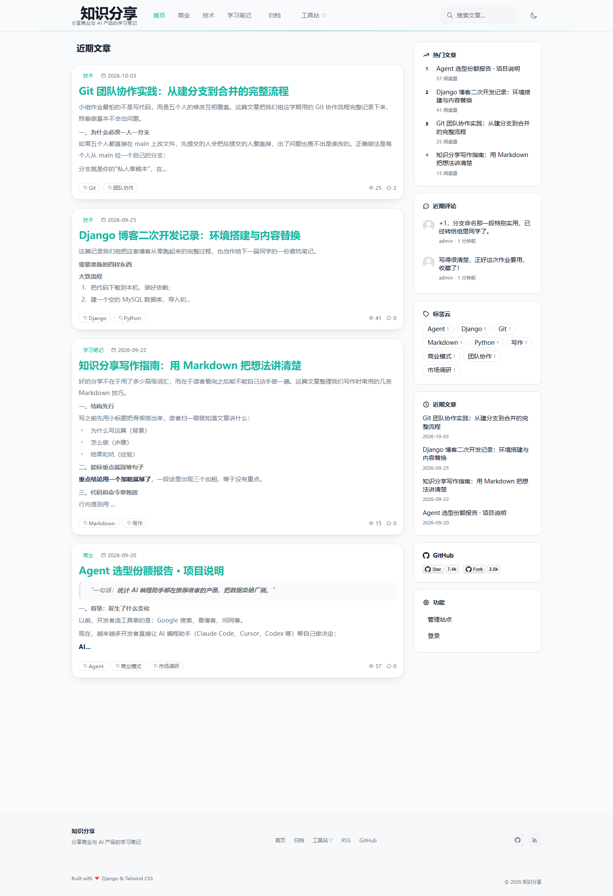
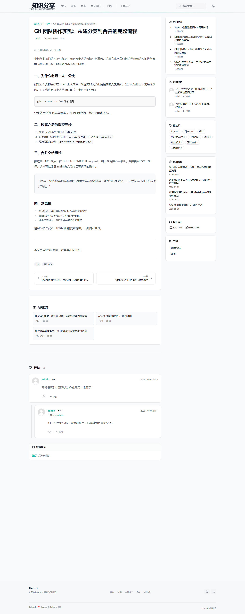
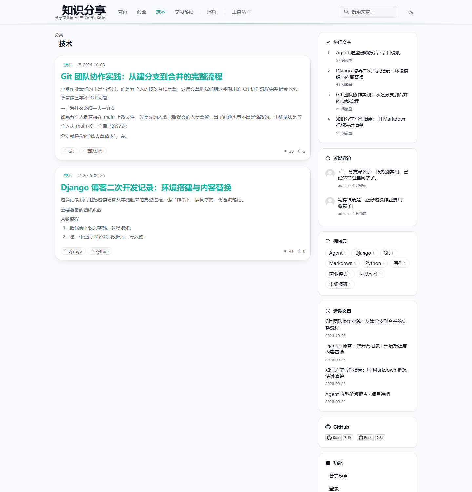

# 01 数据库初始化与主题数据验证

> 对应任务（1）：初始化数据库、选定博客主题，将所有测试数据根据主题实例化。
> 验证人：李子涵　|　分支：`L_branch`　|　日期：2026-11-11

---

## 一、主题定义

小组选定的主题是 **「知识分享」博客**，定位为“分享商业与 AI 产品的学习笔记”。主题不是只改一个站点标题，而是把站点配置、分类、标签、文章、评论、友情链接全部换成同一主题下的测试数据。

| 维度 | 内容 |
|---|---|
| 站点名称 | 知识分享 |
| 站点描述 | 分享商业与 AI 产品的学习笔记 |
| 站点关键词 | AI 产品、商业、需求、创业、产品思维 |
| 分类（3 个） | 商业、技术、学习笔记 |
| 标签（9 个） | Agent、市场调研、商业模式、Git、团队协作、Django、Python、Markdown、写作 |
| 文章（4 篇） | AI 产品 / Git 协作 / Django 二次开发 / Markdown 写作 |
| 评论（2 条） | 一条主评论 + 一条嵌套回复，均挂在 Git 文章下 |
| 友情链接（3 条） | Django 官方文档、DjangoBlog 开源项目、GitHub |

主题的“站点名称/描述/关键词”写在 `blog_blogsettings` 表中，不是硬编码在模板里；分类、标签、文章、评论、链接则分别落在 `blog_category`、`blog_tag`、`blog_article`、`comments_comment`、`blog_links` 表中。

---

## 二、初始化环境

| 项目 | 值 |
|---|---|
| 操作系统 | Windows |
| MySQL | 8.0.42（本机 `MySQL80` 服务） |
| 初始化脚本 | `dailyblog.sql`（770 行，由 MySQL 9.4.0 导出） |
| 字符集 | `utf8mb4` / `utf8mb4_unicode_ci` |
| 验证库 | `dailyblog_week4_verify`（**独立库，避免覆盖本机已有 `dailyblog`**） |

> 为什么用独立库：本机原来的 `dailyblog` 库里只有 1 篇文章、1 个分类、0 条评论，和脚本里的主题数据不一致。直接导入会覆盖旧库，无法对比“导入前/导入后”；新建 `dailyblog_week4_verify` 可以证明脚本本身能从零建起一套完整主题数据。

---

## 三、导入步骤（可复现）

### 1. 建库

```bash
mysql -u root -p -e "DROP DATABASE IF EXISTS dailyblog_week4_verify; CREATE DATABASE dailyblog_week4_verify CHARACTER SET utf8mb4 COLLATE utf8mb4_unicode_ci;"
```

### 2. 导入

Windows `cmd`：

```bat
mysql --default-character-set=utf8mb4 -u root -p dailyblog_week4_verify < dailyblog.sql
```

Linux / macOS / Git Bash：

```bash
mysql --default-character-set=utf8mb4 -u root -p dailyblog_week4_verify < dailyblog.sql
```

### 3. 校验行数

```sql
SELECT 'article' AS table_name, COUNT(*) AS rows_count FROM blog_article
UNION ALL SELECT 'category', COUNT(*) FROM blog_category
UNION ALL SELECT 'tag', COUNT(*) FROM blog_tag
UNION ALL SELECT 'comment', COUNT(*) FROM comments_comment
UNION ALL SELECT 'user', COUNT(*) FROM accounts_bloguser
UNION ALL SELECT 'link', COUNT(*) FROM blog_links;
```

实际结果：

| 表 | 行数 | 说明 |
|---|---:|---|
| `blog_article` | 4 | 4 篇主题文章 |
| `blog_category` | 3 | 商业 / 技术 / 学习笔记 |
| `blog_tag` | 9 | 每篇文章 2～3 个标签 |
| `comments_comment` | 2 | 1 条主评论 + 1 条回复 |
| `accounts_bloguser` | 1 | 测试管理员 `admin` |
| `blog_links` | 3 | Django / DjangoBlog / GitHub |

导入过程 **0 报错**，只有 MySQL 命令行“密码明文提示”的安全警告，不影响数据。

---

## 四、主题数据明细

### 1. 文章（4 篇）

| ID | 标题 | 分类 | 标签 | 浏览 | 发布时间 |
|---:|---|---|---|---:|---|
| 7 | Agent 选型份额报告 · 项目说明 | 商业 | Agent / 市场调研 / 商业模式 | 57 | 2026-09-20 |
| 8 | Git 团队协作实践：从建分支到合并的完整流程 | 技术 | Git / 团队协作 | 27 | 2026-10-03 |
| 9 | Django 博客二次开发记录：环境搭建与内容替换 | 技术 | Django / Python | 41 | 2026-09-25 |
| 10 | 知识分享写作指南：用 Markdown 把想法讲清楚 | 学习笔记 | Markdown / 写作 | 15 | 2026-09-22 |

四篇文章正好覆盖“知识分享”主题的四个侧面：

- **商业/AI**：Agent 选型的行业观察，体现“商业与 AI 产品”定位；
- **团队协作**：Git 分支流程，直接对应本周的版本管理要求；
- **技术实践**：Django 博客二次开发，记录项目本身怎么搭起来；
- **写作方法**：Markdown 写作指南，呼应“知识分享”的表达方式。

### 2. 评论（2 条，含嵌套回复）

| ID | 内容 | 所属文章 | 作者 | 父评论 |
|---:|---|---|---|---|
| 1 | 写得很清楚，正好这次作业要用，收藏了！ | 《Git 团队协作实践》 | admin | 无 |
| 2 | +1，分支命名那一段特别实用，已经转给组里同学了。 | 《Git 团队协作实践》 | admin | 1 |

第 2 条是第 1 条的回复，用来验证评论区的**嵌套回复**渲染（对应 `comment_item_modern.html` 的自包含递归）。

### 3. 分类与标签

| 分类 | slug | 文章数 |
|---|---|---:|
| 商业 | `shang-ye` | 1 |
| 技术 | `ji-zhu` | 2 |
| 学习笔记 | `xue-xi-bi-ji` | 1 |

| 标签 | slug | 标签 | slug |
|---|---|---|---|
| Agent | `agent` | Git | `git` |
| 市场调研 | `shi-chang-diao-yan` | 团队协作 | `tuan-dui-xie-zuo` |
| 商业模式 | `shang-ye-mo-shi` | Django | `django` |
| Python | `python` | Markdown | `markdown` |
| 写作 | `xie-zuo` | | |

### 4. 友情链接

| 名称 | 地址 |
|---|---|
| Django 官方文档 | <https://docs.djangoproject.com/> |
| DjangoBlog 开源项目 | <https://github.com/liangliangyy/DjangoBlog> |
| GitHub | <https://github.com/> |

---

## 五、与页面的对应关系

数据库里的数据最终由下面这些模板渲染，可与包图/说明书对照：

| 数据 | 渲染位置 | 模板 |
|---|---|---|
| 站点名称/描述/关键词 | 顶部导航、页脚、`<head>` | `share_layout/nav.html`、`footer.html`、`base.html` |
| 分类 | 顶部导航下拉、侧边栏 | `nav.html`、`blog/tags/sidebar.html` |
| 文章列表 | 首页、分类页、标签页、归档页 | `blog/article_index.html` + `blog/tags/article_info.html` |
| 文章正文/评论 | 文章详情页 | `blog/article_detail.html` + `comments/tags/comment_list_modern.html` |
| 标签 | 文章卡片、详情页标签区、标签云 | `blog/tags/article_tag_list.html`、`sidebar.html` |
| 友情链接 | 友链页 | `blog/links_list.html` |

页面截图（小组已有，直接引用）：







---

## 六、结论与注意事项

### 结论

1. `dailyblog.sql` 能在**全新空库**中一次性建表并导入全部主题数据，导入 0 报错；
2. 数据覆盖站点配置、分类、标签、文章、评论、链接六类，数量与说明书/截图一致；
3. 文章、分类、标签、评论、链接都围绕“知识分享”主题，不是通用 Lorem Ipsum 或默认示例数据；
4. 管理员密码已重置为测试密码，脚本不包含 OAuth token、邮件日志、会话数据，符合“测试数据脱敏”要求。

### 注意事项

1. **不要直接覆盖本机旧库**：本机 `dailyblog` 库是早期数据（1 篇文章），演示前如需统一，请先备份再重建；本次验证特意使用 `dailyblog_week4_verify`。
2. **测试账号仅用于课程演示**：`admin / admin123456` 是脚本里的测试密码，不能用于任何公网部署。
3. **MySQL 版本**：脚本由 9.4.0 导出，本次在 8.0.42 上导入成功；如果组员本机是 5.7，可能不支持 `utf8mb4_0900_ai_ci` 等排序规则，需要把排序规则改成 `utf8mb4_unicode_ci`。
4. **字符集**：导入时必须带 `--default-character-set=utf8mb4`，否则 Windows 命令行可能按 GBK 解释，中文会乱码。
5. 页面有 10 小时缓存，导入新数据后如果页面不变，重启一次 `runserver` 或清缓存即可。

---

## 附：本次验证的原始查询输出

```text
article    4
category   3
tag        9
comment    2
user       1
link       3
```

文章：

```text
7  | Agent 选型份额报告 · 项目说明 | 商业 | views=57 | Agent/市场调研/商业模式
8  | Git 团队协作实践：从建分支到合并的完整流程 | 技术 | views=27 | Git/团队协作
9  | Django 博客二次开发记录：环境搭建与内容替换 | 技术 | views=41 | Django/Python
10 | 知识分享写作指南：用 Markdown 把想法讲清楚 | 学习笔记 | views=15 | Markdown/写作
```
