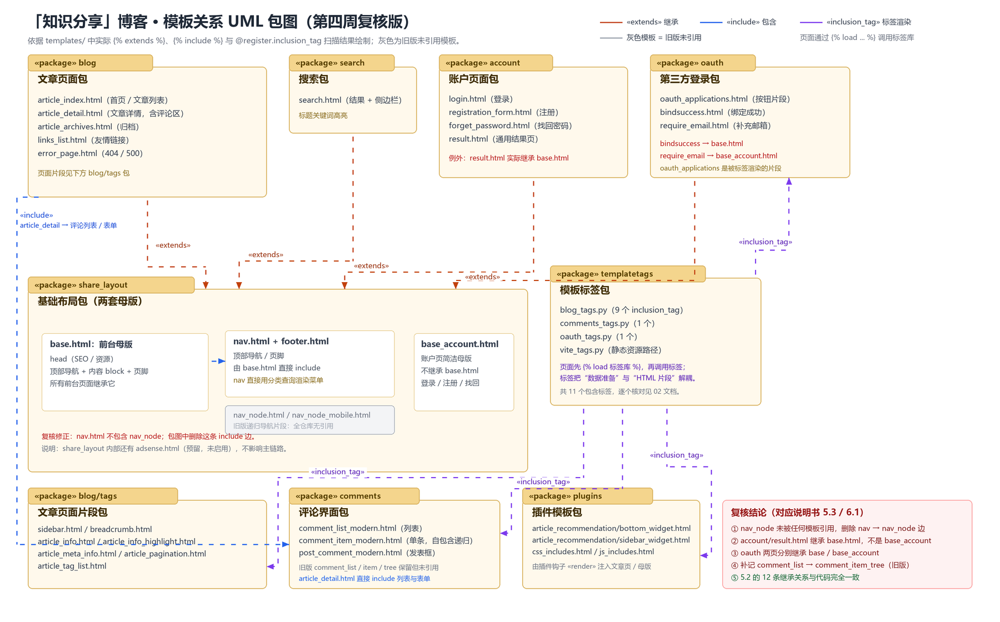

# 02 模板关系复核与 UML 包图

> 对应任务（3）：分析界面对应的模板功能、模板之间/模板与 tag 之间的继承与包含关系，使用 UML 包图绘制。
> 复核人：李子涵　|　分支：`L_branch`　|　复核对象：`doc/界面设计说明书.md` 第 5、6 章
> 复核方式：静态扫描 `templates/` 与各应用 `templatetags/`，不启动服务、不连数据库。

---

## 一、复核方法

1. 扫描 `templates/**/*.html`，提取：
   - ``：模板继承；
   - ``：模板包含；
   - ``：页面加载了哪些标签库。
2. 扫描 `*/templatetags/*.py`，提取 `@register.inclusion_tag("...")` 的函数与它渲染的片段模板。
3. 对 `nav_node` 做全仓库引用检查（排除 `doc/` 与本文件），确认它是否仍被使用。
4. 把扫描结果与说明书 5.2、5.3、5.4、6.1、6.2、附录 A.3 逐条对照。

复现命令：

```bash
python doc/第四周实践任务/tools/audit_templates.py --check
```

本次统计：

| 项目 | 数量 |
|---|---:|
| HTML 模板文件 | 38 |
| 继承关系（extends） | 12 |
| 包含关系（include，字面路径） | 7 |
| 包含标签（inclusion_tag） | 11 |

完整清单见 [`模板关系清单.md`](模板关系清单.md)。

---

## 二、继承关系（12 条，全部正确）

| 子模板 | 父模板 | 说明 |
|---|---|---|
| `account/forget_password.html` | `share_layout/base_account.html` | 账户页 |
| `account/login.html` | `share_layout/base_account.html` | 登录 |
| `account/registration_form.html` | `share_layout/base_account.html` | 注册 |
| `account/result.html` | `share_layout/base.html` | **例外：结果页走前台母版** |
| `blog/article_archives.html` | `share_layout/base.html` | 归档 |
| `blog/article_detail.html` | `share_layout/base.html` | 文章详情 |
| `blog/article_index.html` | `share_layout/base.html` | 首页/列表 |
| `blog/error_page.html` | `share_layout/base.html` | 404/500 |
| `blog/links_list.html` | `share_layout/base.html` | 友链 |
| `oauth/bindsuccess.html` | `share_layout/base.html` | **例外：绑定成功走前台母版** |
| `oauth/require_email.html` | `share_layout/base_account.html` | 补充邮箱 |
| `search/search.html` | `share_layout/base.html` | 搜索 |

结论：说明书 **5.2 节的 12 条继承关系与代码完全一致**，包括两个容易被忽略的例外（`account/result.html`、`oauth/bindsuccess.html`）。

---

## 三、包含关系（7 条字面路径 + 1 条变量递归）

| 宿主模板 | 被包含模板 | 代码位置/说明 |
|---|---|---|
| `blog/article_detail.html` | `comments/tags/comment_list_modern.html` | 评论区列表 |
| `blog/article_detail.html` | `comments/tags/post_comment_modern.html` | 发表评论框 |
| `comments/tags/comment_item_modern.html` | 自身 | 嵌套回复逐层渲染 |
| `comments/tags/comment_list.html` | `comments/tags/comment_item_tree.html` | **旧版评论列表，说明书 5.3 漏记** |
| `comments/tags/comment_list_modern.html` | `comments/tags/comment_item_modern.html` | 现代版列表 → 单条 |
| `share_layout/base.html` | `share_layout/nav.html` | 母版嵌入导航 |
| `share_layout/base.html` | `share_layout/footer.html` | 母版嵌入页脚 |

另外：

- `comments/tags/comment_item_tree.html` 第 47～54 行通过变量 `` 递归包含自身；模板名是变量，所以正则扫描不会把它算进上表。
- `templates/share_layout/nav_node.html` 内部也通过变量自我递归；`nav_node.html` 与 `nav_node_mobile.html` 都**没有任何外部模板引用**（见下节）。

---

## 四、模板与 tag 的关系（11 个包含标签）

| 标签库 | 标签函数 | 渲染模板 |
|---|---|---|
| `blog_tags` | `load_breadcrumb` | `blog/tags/breadcrumb.html` |
| `blog_tags` | `load_articletags` | `blog/tags/article_tag_list.html` |
| `blog_tags` | `load_sidebar` | `blog/tags/sidebar.html` |
| `blog_tags` | `load_article_metas` | `blog/tags/article_meta_info.html` |
| `blog_tags` | `load_pagination_info` | `blog/tags/article_pagination.html` |
| `blog_tags` | `load_article_detail` | `blog/tags/article_info.html` |
| `blog_tags` | `load_article_detail_with_highlight` | `blog/tags/article_info_highlight.html` |
| `blog_tags` | `plugin_compressed_css` | `plugins/css_includes.html` |
| `blog_tags` | `plugin_compressed_js` | `plugins/js_includes.html` |
| `comments_tags` | `show_comment_item` | `comments/tags/comment_item.html`（旧版，当前界面未引用） |
| `oauth_tags` | `load_oauth_applications` | `oauth/oauth_applications.html` |

结论：说明书 **5.4 节的标签表与代码一致**；实际共 11 个 `inclusion_tag`，`head_meta` 不是包含标签（它执行钩子、返回字符串），说明书中已单独注明，正确。

---

## 五、发现的 5 处偏差

### 偏差 1（错误依赖）：`nav.html` 并不包含 `nav_node.html`

**说明书原文（5.3 表）**：

> `share_layout/nav.html` → `share_layout/nav_node.html` / `nav_node_mobile.html`：分类树（片段自身递归展开子分类）

**实际情况**：

- `templates/share_layout/nav.html` 第 42、44 行（桌面端）和第 207、209 行（移动端）直接使用 `` 查询并渲染分类，**没有任何 ``**。
- `nav_node.html` / `nav_node_mobile.html` 只在自己的文件内部通过 `` 自我递归；全仓库对 `nav_node` 的引用数为 **0**（排除这两个文件自身与 `doc/`）。
- 它们是旧版导航片段，当前模板链路已不再使用。

**影响**：6.1 包图和附录 A.3 的 Mermaid 源码都画了 `NAV → NAVNODE` 的 `«include»` 边，读者会误以为导航依赖这两个文件。

---

### 偏差 2（漏记）：`comment_list.html → comment_item_tree.html`

**实际情况**：`templates/comments/tags/comment_list.html` 第 19 行：

```django

```

说明书的 5.3 表只记了 `comment_item_tree.html` 自我递归，没有记“旧版列表包含旧版单条”这条边。

**影响**：影响很小（旧版评论模板当前未被界面使用），但既然 5.3 表的目标是完整列出 include 关系，建议补一行并标注“旧版，未被视图引用”。

---

### 偏差 3（包图与 5.2 矛盾）：`account` 包不是全部继承 `base_account`

**5.2 表**写得很清楚：

- `account/login.html`、`registration_form.html`、`forget_password.html` → `base_account.html`；
- `account/result.html` → `base.html`。

**6.1 包图 / 附录 A.3** 却把整个 `account` 包画成只指向 `base_account.html`，`result.html` 的继承目标丢失。

**影响**：读者会以为 `result.html` 也用账户母版，和 5.2 表冲突。

---

### 偏差 4（包图与 5.2 矛盾）：`oauth` 包的两个页面继承目标不同

**5.2 表**：

- `oauth/bindsuccess.html` → `base.html`；
- `oauth/require_email.html` → `base_account.html`；
- `oauth/oauth_applications.html` 是被 `` 渲染的**片段**，不继承任何母版。

**6.1 包图 / 附录 A.3** 把整个 `oauth` 包画成只指向 `base.html`，`require_email.html` 的继承目标丢失；`oauth_applications.html` 也被混在“页面”里。

---

### 偏差 5（旧模板未标注）：`nav_node*.html` 在 5.1 中仍像在用

**5.1 表**：

> `nav_node.html`、`nav_node_mobile.html`：递归渲染分类树的导航片段（含嵌套子分类）

这句话本身没错，但没有说明“当前未被引用”。配合 5.3/6.1 的错误边，会让人以为它们是导航主链路的一部分。建议改成：

> 旧版递归导航片段（当前未被任何模板引用；现由 `nav.html` 直接用分类查询渲染）

---

## 六、修正版 UML 包图



矢量源文件：[`imgs/template-packages-corrected.svg`](imgs/template-packages-corrected.svg)。

### 读图说明

| 构造型 | 含义 | 例子 |
|---|---|---|
| `«extends»` | 页面继承母版 | `blog` 的 5 个页面 → `base.html` |
| `«include»` | 模板静态包含片段 | `base.html` → `nav.html` + `footer.html`；`article_detail.html` → 评论列表/表单 |
| `«inclusion_tag»` | 标签库渲染片段模板 | `templatetags` → `blog/tags`、`comments`、`oauth`、`plugins` |
| 灰色 | 旧版未引用 | `nav_node.html` / `nav_node_mobile.html` |

### 这张图相对原图改了什么

1. **删掉** `nav.html → nav_node*.html` 的 `«include»` 边；
2. **拆开** `account` 的继承：3 个账户页 → `base_account.html`，`result.html` → `base.html`；
3. **拆开** `oauth` 的继承：`bindsuccess.html` → `base.html`，`require_email.html` → `base_account.html`；
4. 把 `nav_node*.html` 画成灰色“旧版未引用”，不再参与主链路；
5. 保留 5.2 的 12 条继承关系不变，并在图内用红字标出两个例外，避免“包级箭头”掩盖细节。

---

## 七、给组长/席佳宁的修改建议

> 按小组《界面设计说明书-任务分工.md》的约定：“发现别人负责的内容有问题，写在自己的检查记录里，交给对应的人去改。”以下只给建议，不直接改第 5、6 章正文。

| 序号 | 位置 | 建议 |
|---:|---|---|
| 1 | 5.1 `nav_node` 行 | 标注“旧版，当前未被引用” |
| 2 | 5.3 表 | 删除 `nav.html → nav_node/nav_node_mobile` 一行；新增 `comment_list.html → comment_item_tree.html`（旧版）一行 |
| 3 | 6.1 | 用 [`imgs/template-packages-corrected.png`](imgs/template-packages-corrected.png) 替换 `doc/imgs/diagrams/diagram-03-packages.png`，或按本图重画 |
| 4 | 6.2 依赖表 | 把“各页面包 → share_layout”展开为：account 3 页 → base_account、result → base；oauth bindsuccess → base、require_email → base_account；删除 nav → nav_node |
| 5 | 附录 A.3 Mermaid | 删除 `NAV -.-> NAVNODE`；把 `AFILES`、`OFILES` 拆成具体页面节点后再连 `BASE/BASEACC` |
| 6 | 5.2 / 5.4 | 无需修改（12 条继承、11 个包含标签均与代码一致） |

---

## 八、结论

1. 说明书第 5.2 节（继承）和第 5.4 节（标签）是准确的，可以作为模板分析的基线；
2. 第 5.3 节有 **1 条错误边 + 1 条漏记**；
3. 第 6.1 节包图和附录 A.3 的 Mermaid 源码有 **2 处包级继承错误 + 1 条 nav_node 错误边**；
4. 修正版包图已经生成，能同时表达 12 条继承、7 条包含、11 个包含标签，并把旧模板明确标灰；
5. 以上结论均可用 `tools/audit_templates.py --check` 复现，不依赖人工记忆。
