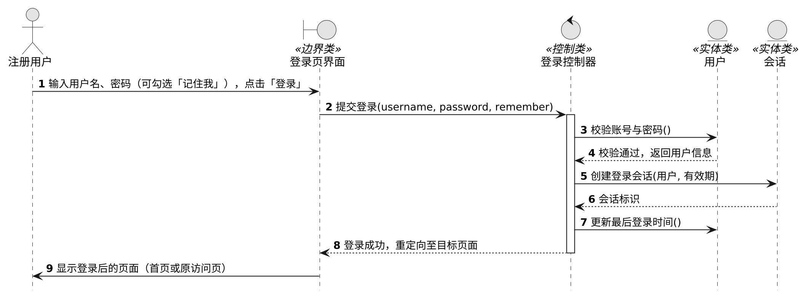
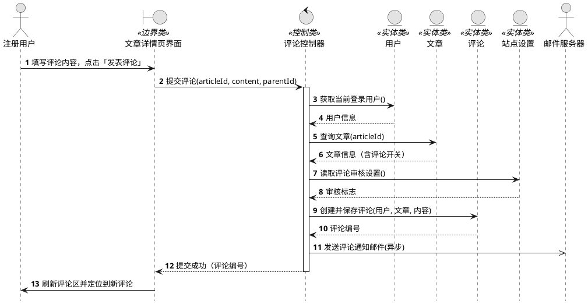
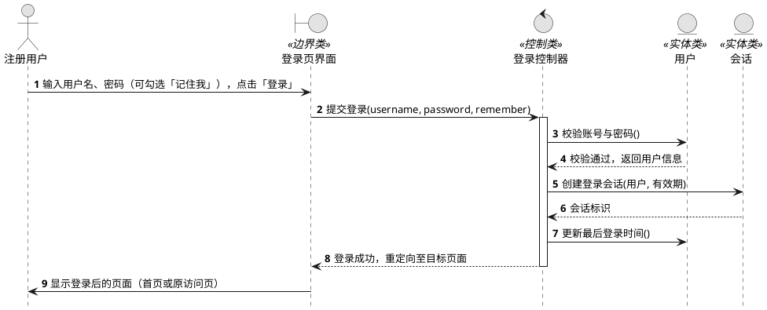

# 顺序图 · 发表评论与用户登录

| 项目名称 | 基于开源项目 DjangoBlog 二次开发的「知识分享」博客 |
|---|---|
| 开发小组 | 第 13 组 |
| 依据 | 教材 UML 顺序图（用例执行场景建模） |
| 要求 | 从项目用例图中选 2 个核心用例，各画一张顺序图；每个用例设计 1 个界面类、1 个控制类、若干实体类；只画主要执行场景，不考虑分支 |
| 编写日期 | 2026-10-11 |

---

## 1 用例选择与理由

| 用例 | 编号（对应用例图） | 选它的理由 |
|---|---|---|
| **发表评论** | U14 | 系统最核心的用户互动功能；涉及界面、控制、4 个实体类，并牵出外部执行者"邮件服务器"，最能体现顺序图的对象协作；且与已提交的《用例说明-发表评论》前后呼应 |
| **用户登录** | U8 | 系统核心入口，所有账户类操作的前置；能展示"会话"实体与"记住我"有效期，账户类建模的代表 |

> 如需换成「第三方登录」（多一个外部执行者"第三方登录平台"）或「找回密码」（多"验证码/邮件服务器"），类设计与消息流可快速替换。

---

## 2 用例一：发表评论

### 2.1 类设计（1 界面类 + 1 控制类 + 4 实体类）

| 类名 | 类别 | 职责 | 对应系统实现 |
|---|---|---|---|
| 文章详情页界面 | 界面类（«boundary»） | 展示评论区输入框与「发表评论」按钮；提交评论；刷新评论区并定位新评论 | `templates/blog/article_detail.html`、`templates/comments/tags/post_comment_modern.html` |
| 评论控制器 | 控制类（«control»） | 接收提交；校验登录状态与文章评论开关；校验内容（非空、≤300 字）；协调实体保存；触发通知邮件 | `comments/views.py` · `CommentPostView` |
| 用户 | 实体类（«entity»） | 当前登录用户的身份信息 | `accounts/models.py` · `BlogUser` |
| 文章 | 实体类（«entity»） | 被评论的文章及其评论开关 | `blog/models.py` · `Article` |
| 评论 | 实体类（«entity»） | 评论正文、所属文章/用户、父评论、是否启用（审核） | `comments/models.py` · `Comment` |
| 站点设置 | 实体类（«entity»） | 评论是否需要审核等站点参数 | `blog/models.py` · `BlogSettings` |
| 邮件服务器 | 外部执行者（非类） | 异步递送评论通知邮件（用例图中的次要参与者） | `djangoblog/utils.py` · `send_email` |

### 2.2 顺序图

### 2.3 消息说明（主要执行场景）

| 序号 | 消息 | 说明 |
|---|---|---|
| 1 | 填写评论内容，点击「发表评论」 | 用户在文章详情页评论区发起用例 |
| 2 | 提交评论(articleId, content, parentId) | 界面类把评论数据交给控制类（parentId 为空即为普通评论，回复时由子用例「回复评论」传入） |
| 3 | 获取当前登录用户() | 控制类向用户实体取当前用户信息 |
| 4 | 用户信息 | 返回当前用户 |
| 5 | 查询文章(articleId) | 读取被评论文章（含评论开关） |
| 6 | 文章信息（含评论开关） | 返回文章信息 |
| 7 | 读取评论审核设置() | 读取站点设置中的"评论需审核"标志 |
| 8 | 审核标志 | 返回标志，供控制类决定评论的启用状态 |
| 9 | 创建并保存评论(用户, 文章, 内容) | 控制类创建评论实体并保存（内容校验在控制类内完成，图中省略） |
| 10 | 评论编号 | 返回保存结果 |
| 11 | 发送评论通知邮件(异步) | 空心箭头：异步消息，邮件发送不阻塞本次提交（发给评论者，回复时另发被回复者） |
| 12 | 提交成功（评论编号） | 控制类向界面类返回结果 |
| 13 | 刷新评论区并定位到新评论 | 界面类刷新并定位到新评论（锚点定位） |

**场景假设（不考虑分支）**：用户已登录、文章评论开关为开启、评论内容合法、站点未开启审核（评论立即显示）、邮件发送成功。

---

## 3 用例二：用户登录

### 3.1 类设计（1 界面类 + 1 控制类 + 2 实体类）

| 类名 | 类别 | 职责 | 对应系统实现 |
|---|---|---|---|
| 登录页界面 | 界面类（«boundary»） | 用户名/密码/「记住我」表单；展示登录结果 | `templates/account/login.html` |
| 登录控制器 | 控制类（«control»） | 接收登录请求；校验账号密码；建立会话；重定向 | `accounts/views.py` · `LoginView` |
| 用户 | 实体类（«entity»） | 账号、密码摘要、最后登录时间 | `accounts/models.py` · `BlogUser` |
| 会话 | 实体类（«entity»） | 登录会话与会话有效期（「记住我」延长有效期） | `django.contrib.sessions` |

### 3.2 顺序图

### 3.3 消息说明（主要执行场景）

| 序号 | 消息 | 说明 |
|---|---|---|
| 1 | 输入用户名、密码（可勾选「记住我」），点击「登录」 | 用户发起用例 |
| 2 | 提交登录(username, password, remember) | 界面类把表单数据交给控制类 |
| 3 | 校验账号与密码() | 控制类通过用户实体校验身份（密码以摘要比对） |
| 4 | 校验通过，返回用户信息 | 返回用户信息 |
| 5 | 创建登录会话(用户, 有效期) | 建立登录会话；勾选「记住我」则延长有效期 |
| 6 | 会话标识 | 返回会话标识 |
| 7 | 更新最后登录时间() | 单向消息：更新用户的最后登录时间 |
| 8 | 登录成功，重定向至目标页面 | 控制类向界面类返回结果 |
| 9 | 显示登录后的页面（首页或原访问页） | 界面类展示登录后的页面 |

**场景假设（不考虑分支）**：账号密码正确、账号已激活。

---

## 4 与用例图、用例说明的对应关系

1. 两个用例都在用例图中：「发表评论」为 U14（注册用户—发表评论关联；回复评论是其子用例）；「用户登录」为 U8（第三方登录是其子用例）。
2. 本顺序图是《用例说明-发表评论》中**基本事件流**的对象协作展开——事件流的每一步都能在图中找到对应的消息。
3. 图 1 中的「邮件服务器」与用例图中的外部执行者一致（评论通知邮件的异步发送）；「站点设置」实体对应用例说明中的业务规则 BR3（评论审核）。
4. 按题目要求只画**主要执行场景**：未登录跳转、评论审核待审、邮件发送失败、密码错误等分支均不在图中体现（在用例说明的备选/异常流中已有交代）。

**读图说明**：实线箭头 = 调用/消息；虚线箭头 = 返回；空心箭头（→）表示异步消息。

---

## 附录 A 图源（PlantUML，可重新渲染）

> 两份源码已保存为 `doc/imgs/diagrams/sequence_comment.puml`、`sequence_login.puml`，粘贴到任意 PlantUML 渲染器（如 kroki.io）即可重新出图。

**A.1 发表评论**

**A.2 用户登录**

